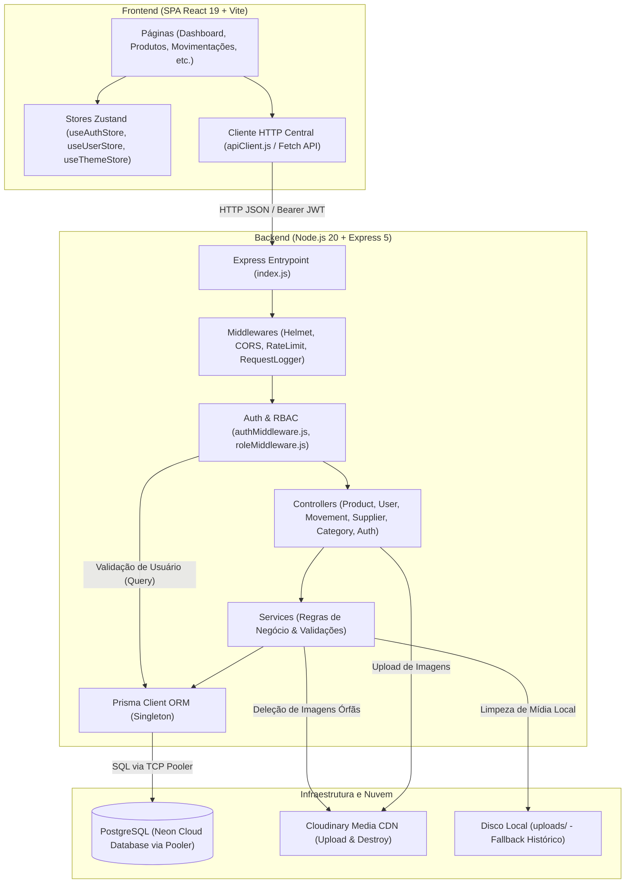

# 📑 RELATÓRIO TÉCNICO 01 — VISÃO GERAL, INVENTÁRIO E ARQUITETURA
## Projeto: Estoque.OS — Sistema de Gerenciamento e Controle de Estoque
**Data da Auditoria:** 2026-11-08  
**Classificação do Projeto:** Nível de Refinamento `MEDIUM`  
**Responsável Técnico:** Senior Software Architect / Lead Auditor  
**Documento de Origem:** `PROMPT_MASTER_UNIFICADO.md`  

---

## 1. Identificação do Projeto e Nível de Auditoria

- **Nome do Projeto:** `Estoque.OS` (repositório: `adm-estoque`)
- **Tipo de Aplicação:** Aplicação Web Fullstack Desacoplada (Backend RESTful API em Node.js/Express + Frontend SPA em React/Vite)
- **Nível Selecionado:** `MEDIUM` (cumulativo com LOW)
  - **Justificativa Técnica:** O sistema atende a um cenário operacional corporativo com múltiplos perfis de acesso (`ADMIN`, `GERENTE`, `OPERADOR`), concorrência em saldos e estoques, exigência de agregação analítica em tempo real (gráficos temporais, contabilidade patrimonial e volumetria de vendas vs. reposições), histórico auditável de transações e requisito de escalabilidade para suportar **mais de 100 usuários simultâneos**. O nível `MEDIUM` abrange controle de concorrência, idempotência, mitigação de N+1 queries, estratégias de pooling de conexões e estruturação de observabilidade/cache.
- **Premissas e Requisitos Conhecidos:**
  - Usuários simultâneos esperados: **+100 usuários simultâneos** `[INFERIDO DO CONTEXTO DE ENTRADA]`.
  - Stack obrigatória pré-existente: Node.js, Express.js 5, Prisma ORM, PostgreSQL (hospedado no Neon Database), React 19, Tailwind CSS, Zustand, Cloudinary SDK `[IMPLEMENTADO (verificado)]`.
  - Política de alteração de código na etapa atual: `PODE_ALTERAR_CODIGO = NAO` (Auditoria e Mapeamento Estrito) `[IMPLEMENTADO (verificado)]`.

---

## 2. Visão Geral do Produto e do Negócio

### 2.1 Em Linguagem de Negócio (Sumário Executivo)
O **Estoque.OS** é uma plataforma centralizada de controle de mercadorias, movimentações de entrada e saída e auditoria operacional, projetada para pequenas e médias empresas do setor varejista, distribuidores e centros de armazenagem. A ferramenta resolve diretamente as dores de desencontro de inventário, perdas de estoque, falta de rastreabilidade de operadores (quem vendeu ou repôs cada item) e ausência de visibilidade financeira sobre o patrimônio imobilizado em prateleira. Permite que gestores monitorem em tempo real alertas de ruptura (itens abaixo de 10 unidades), analisem o faturamento de vendas por período e controlem com rigor os privilégios operacionais da equipe.

### 2.2 Em Linguagem Técnica (Precisão de Engenharia de Software)
O sistema implementa uma arquitetura **Cliente-Servidor desacoplada** com comunicação estritamente síncrona via **HTTP/REST JSON**.
- **Ponto de Entrada da API:** [backend/src/index.js](file:///c:/Users/Ique%20Santana/Desktop/Mateus/vscode/projetos/portifolio/Estoque.OS/backend/src/index.js), escutando na porta `5000` (ou variável de ambiente `PORT`).
- **Ponto de Entrada da SPA:** [frontend/src/main.jsx](file:///c:/Users/Ique%20Santana/Desktop/Mateus/vscode/projetos/portifolio/Estoque.OS/frontend/src/main.jsx), servido via Vite na porta local `5173`.
- **Mecanismo de Autenticação:** Autenticação baseada em tokens **JWT (JSON Web Token)** transmitidos no cabeçalho `Authorization: Bearer <token>`, com expiração configurada para 8 horas (`expiresIn: '8h'`).
- **Autorização (RBAC):** Middleware customizado [backend/src/middlewares/roleMiddleware.js](file:///c:/Users/Ique%20Santana/Desktop/Mateus/vscode/projetos/portifolio/Estoque.OS/backend/src/middlewares/roleMiddleware.js) (`permit(...)`) que avalia se a role do usuário autenticado pertence ao conjunto de permissões exigidas para cada rota.
- **Camada de Dados e Persistência:** PostgreSQL hospedado em nuvem no **Neon Database**, acessado via **Prisma ORM 6.16.2** através de uma conexão pooler (`ep-bold-poetry-...-pooler.c-2.us-east-1.aws.neon.tech`).
- **Camada de Mídia (Assets):** Armazenamento em nuvem no **Cloudinary** via SDK v2 (`cloudinary`), gerenciado por upload temporário local via **Multer 2.0.2** com exclusão automática pós-upload.

---

## 3. Matriz Tecnológica e Dependências

### 3.1 Backend Runtime e Bibliotecas
| Tecnologia / Pacote | Versão Real | Finalidade e Responsabilidade no Sistema | Status |
| :--- | :--- | :--- | :---: |
| **Node.js** | `v20.19.0` (LTS) | Ambiente de execução JavaScript no servidor (ES Modules nativo) | `IMPLEMENTADO (verificado)` |
| **Express.js** | `^5.1.0` | Framework web e roteamento HTTP da API RESTful | `IMPLEMENTADO (verificado)` |
| **Prisma Client & CLI** | `^6.16.2` | Mapeador Objeto-Relacional (ORM) e gerenciador de schema/migrations | `IMPLEMENTADO (verificado)` |
| **PostgreSQL (Neon)** | Cloud (v16+) | Banco de dados relacional primário com conexão pooler | `IMPLEMENTADO (verificado)` |
| **BcryptJS** | `^3.0.2` | Criptografia irreversível de senhas com salt rounds 10 | `IMPLEMENTADO (verificado)` |
| **JsonWebToken** | `^9.0.2` | Criação e verificação de tokens JWT de sessão stateless | `IMPLEMENTADO (verificado)` |
| **Multer** | `^2.0.2` | Middleware multipart/form-data para captura de upload de imagens | `IMPLEMENTADO (verificado)` |
| **Cloudinary** | `^2.10.0` | SDK oficial para upload, hospedagem e deleção de mídia em CDN | `IMPLEMENTADO (verificado)` |
| **Pino & Pino-Pretty** | `^8.14.0` / `^13.1.3` | Sistema de logging estruturado assíncrono com child loggers | `IMPLEMENTADO (verificado)` |
| **Helmet** | `^7.2.0` | Middleware de cabeçalhos de segurança HTTP | `IMPLEMENTADO (verificado)` |
| **Express Rate Limit** | `^6.8.0` | Limitador de requisições por janela temporal | `IMPLEMENTADO (verificado)` |
| **CORS** | `^2.8.5` | Configuração de Cross-Origin Resource Sharing | `IMPLEMENTADO (verificado)` |
| **Dotenv** | `^17.2.2` | Carregamento de variáveis de ambiente a partir de `.env` | `IMPLEMENTADO (verificado)` |

### 3.2 Frontend Runtime e Bibliotecas
| Tecnologia / Pacote | Versão Real | Finalidade e Responsabilidade no Sistema | Status |
| :--- | :--- | :--- | :---: |
| **React** | `^19.1.1` | Biblioteca de interface declarativa com React Hooks | `IMPLEMENTADO (verificado)` |
| **Vite** | `^7.1.6` | Bundler e servidor de desenvolvimento frontend ultrarrápido | `IMPLEMENTADO (verificado)` |
| **React Router DOM** | `^7.9.1` | Gerenciamento de roteamento client-side e guardas de rota | `IMPLEMENTADO (verificado)` |
| **Zustand** | `^5.0.8` | Gerenciamento de estado global leve com persistência em localStorage | `IMPLEMENTADO (verificado)` |
| **Tailwind CSS** | `^3.4.17` | Framework utilitário de CSS com suporte a tema Dark/Light | `IMPLEMENTADO (verificado)` |
| **Recharts** | `^3.3.0` | Biblioteca de visualização de dados (gráficos de barras, linhas, pizza e área) | `IMPLEMENTADO (verificado)` |
| **Lucide React / React Icons** | `^0.562.0` / `^5.5.0` | Conjunto iconográfico para navegação e ações de interface | `IMPLEMENTADO (verificado)` |
| **Framer Motion** | `^12.23.22` | Animações de transição de elementos de tela | `IMPLEMENTADO (verificado)` |

---

## 4. Árvore Completa do Repositório e Descrição dos Componentes

```
Estoque.OS/
├── 00_REGISTRO_DE_PROGRESSO.md         # Registro de progresso de auditoria e status de etapas
├── PROMPT_MASTER_UNIFICADO.md          # Diretrizes mestras e catálogo de auditoria técnica
├── README.md                           # Documentação original do projeto
├── relatorios/                         # Pasta consolidada de relatórios técnicos de auditoria
│   └── 01_visao_geral_e_inventario.md  # Relatório da Fase 1 (Visão Geral e Inventário)
├── backend/                            # Módulo de Backend (API RESTful)
│   ├── .env                            # Variáveis de ambiente backend (DATABASE_URL, JWT, Cloudinary)
│   ├── .gitignore                      # Regras de exclusão do git para o backend
│   ├── package.json                    # Dependências e scripts do servidor Node.js
│   ├── package-lock.json               # Lockfile de dependências (excluído de auditoria de código)
│   ├── prisma/                         # Configurações do Banco de Dados e ORM
│   │   ├── schema.prisma               # Modelos relacionais (Usuario, Categoria, Fornecedor, Produto, Movimento)
│   │   ├── migrations/                 # Histórico evolutivo de migrações SQL
│   │   │   ├── migration_lock.toml     # Lockfile do mecanismo de migrações
│   │   │   ├── 20250918051748_init/    # Migração inicial das 5 entidades
│   │   │   ├── 20251012223132_add_field_imagem_usuario/ # Adição do campo imagem em Usuario
│   │   │   ├── 20260601063115_upd_tabela_fornecedores/  # Adição de contato/endereço em Fornecedor
│   │   │   └── 20261022_alter_enum_reposicao_venda/     # Alteração do enum MovimentoTipo
│   │   ├── reset.js                    # Script utilitário para reset de tabelas
│   │   ├── seed.js                     # Carga inicial completa (Admin, Gerente, Operadores, Produtos, Movimentos)
│   │   └── seedMovements.js            # Carga complementar de histórico de movimentações
│   ├── src/                            # Código-fonte da aplicação backend
│   │   ├── index.js                    # Inicialização do Express, middlewares globais e montagem de rotas
│   │   ├── config/                     # Configurações de infraestrutura e serviços
│   │   │   ├── cloudinaryConfig.js     # Integração com Cloudinary (upload e destroy de imagens)
│   │   │   ├── logger.js               # Instanciação do Pino Logger e childLoggers
│   │   │   ├── multerConfig.js         # Configuração de upload local em disco e validação MIME
│   │   │   └── prismaClient.js         # Instanciação singleton do PrismaClient
│   │   ├── controllers/                # Camada de controle HTTP e orquestração
│   │   │   ├── authController.js       # Endpoints de login e cadastro público
│   │   │   ├── categoryController.js   # CRUD e contagem de categorias
│   │   │   ├── movementController.js   # Histórico de movimentações e agregação de usuário
│   │   │   ├── productController.js    # CRUD de produtos, upload de imagem, stats e ajuste de estoque
│   │   │   ├── supplierController.js   # CRUD e cálculo de fluxo por fornecedor (acesso direto ao Prisma)
│   │   │   └── userController.js       # Gestão de usuários, perfil logado (/me) e lista resumida (/names)
│   │   ├── middlewares/                # Interceptadores de requisições HTTP
│   │   │   ├── authMiddleware.js       # Validação de token JWT e extração de usuário no DB
│   │   │   ├── requestLogger.js        # Log de latência, método, status e IP da requisição
│   │   │   ├── roleMiddleware.js       # Guardrail de autorização por papel (permit: ADMIN, GERENTE, OPERADOR)
│   │   │   └── validationMiddleware.js # Validação de payload e integridade de tipos (body schema)
│   │   ├── routes/                     # Definição formal das rotas e verbos HTTP
│   │   │   ├── authRoutes.js           # Prefix /auth (/login, /register)
│   │   │   ├── categoryRoutes.js       # Prefix /categories (CRUD, /count)
│   │   │   ├── movementRoutes.js       # Prefix /movements (listagem, /user-stats)
│   │   │   ├── productRoutes.js        # Prefix /products (CRUD, /count, /stats, /:id/adjust)
│   │   │   ├── supplierRoutes.js       # Prefix /suppliers (CRUD, /count, /stats)
│   │   │   └── userRoutes.js           # Prefix /users (/me, /names, CRUD restrito)
│   │   ├── services/                   # Camada de regras de negócio e persistência
│   │   │   ├── authService.js          # Autenticação via bcrypt, geração de JWT e registro seguro
│   │   │   ├── categoryService.js      # Validações de duplicidade de nome e vínculo de FK
│   │   │   ├── movementService.js      # Construção de queries complexas e agregação SQL nativa
│   │   │   ├── productService.js       # Paginação dinâmica, transação atômica de saldo e cálculo SQL
│   │   │   ├── supplierService.js      # Regras de negócio de fornecedores (desacoplada do controller)
│   │   │   └── userService.js          # Validações de unicidade, demotion, autoexclusão e sanitização
│   │   └── utils/                      # Funções auxiliares transversais
│   │       ├── errorHandler.js         # Classe AppError e middleware de captura global de exceções
│   │       └── sanitizers.js           # Expurgo de hashes de senhas de objetos de retorno
│   └── uploads/                        # Armazenamento estático local histórico
│       ├── produtos/                   # Imagens locais históricas de produtos
│       └── usuarios/                   # Avatares locais históricos de usuários
└── frontend/                           # Módulo de Frontend (SPA React)
    ├── .env                            # Variáveis de ambiente do frontend (VITE_API_BASE_URL)
    ├── .env.example                    # Template de configuração de ambiente frontend
    ├── .gitignore                      # Regras de exclusão do git para o frontend
    ├── index.html                      # Ponto de entrada HTML do single-page application
    ├── package.json                    # Dependências e scripts do React/Vite
    ├── package-lock.json               # Lockfile de dependências (excluído de auditoria de código)
    ├── postcss.config.js               # Configuração do compilador PostCSS
    ├── tailwind.config.js              # Configuração visual do Tailwind CSS
    ├── vercel.json                     # Configuração de rewrites para deploy SPA na Vercel
    ├── vite.config.js                  # Configuração do Vite bundler
    ├── eslint.config.js                # Configuração do linter ESLint
    ├── public/                         # Ativos públicos e screenshots promocionais
    └── src/                            # Código-fonte da aplicação React
        ├── main.jsx                    # Bootstrap da aplicação e injeção no DOM
        ├── App.jsx                     # Componente raiz provendo RouterProvider
        ├── index.css                   # Definição de tokens de design e variáveis de tema
        ├── dados.js                    # Dados mock legados (código morto)
        ├── assets/                     # SVGs e imagens vetoriais internas
        ├── config/                     # Configurações de roteamento
        │   └── routes.jsx              # Tabela de rotas do React Router DOM
        ├── layout/                     # Estrutura base visual
        │   └── Layout.jsx              # Shell com Sidebar, Header responsivo e Outlet
        ├── pages/                      # Páginas de navegação (Views da SPA)
        │   ├── Auth.jsx                # Tela de Login e Registro com transição
        │   ├── Categorias.jsx          # Gestão e listagem de categorias
        │   ├── Configuracoes.jsx       # Perfil do usuário logado e edição de conta
        │   ├── Dashboard.jsx           # Painel geral analítico de estoque e KPIs
        │   ├── Fornecedores.jsx        # Gestão de parceiros e métricas de fornecimento
        │   ├── Home.jsx                # Landing page de apresentação institucional
        │   ├── Movimentacoes.jsx       # Histórico de fluxo, gráficos de reposição e vendas
        │   ├── Pedidos.jsx             # Visão focada em pedidos operacionais
        │   ├── Produtos.jsx            # Catálogo de produtos com paginação e busca
        │   └── Usuarios.jsx            # Gestão administrativa de usuários e perfis
        ├── components/                 # Componentes de interface modulares
        │   ├── ProtectedRoute.jsx      # Componente guarda de rotas autenticadas
        │   ├── common/                 # Componentes compartilhados
        │   │   ├── Button.jsx          # Botão estilizado com variantes
        │   │   ├── FooterHome.jsx      # Rodapé institucional da landing page
        │   │   ├── Header.jsx          # Cabeçalho mobile com botão de menu
        │   │   ├── HeaderHome.jsx      # Cabeçalho da landing page
        │   │   ├── Input.jsx           # Campo de formulário reutilizável
        │   │   ├── ModalConfirmacao.jsx# Modal para confirmação de ações sensíveis
        │   │   ├── ModalMensagem.jsx   # Modal de alerta/feedback de ações
        │   │   ├── NotFound.jsx        # Página de erro 404 para rotas inválidas
        │   │   ├── NotificationContainer.jsx # Container de notificações flutuantes
        │   │   ├── PaginationControls.jsx    # Barra de paginação reutilizável
        │   │   └── Sidebar.jsx         # Menu lateral fixo com controle de perfil e tema
        │   ├── dashboard/              # Widgets específicos do Dashboard
        │   │   ├── FornecedorDashboard.jsx   # Cards de métricas por parceiro
        │   │   ├── KPISection.jsx      # 4 cards principais de indicadores de estoque
        │   │   ├── LowStockAlert.jsx   # Barra visual de itens críticos (< 10 un)
        │   │   ├── MontanteGrafic.jsx  # Gráfico de área temporal de receita
        │   │   ├── RecentMovements.jsx # Lista resumida das últimas movimentações
        │   │   ├── StockFlowChart.jsx  # Gráfico de barras com fluxo por mercadoria
        │   │   └── UserStatsCharts.jsx # Gráficos comparativos de volume por usuário
        │   ├── forms/                  # Formulários modais e componentes de entrada
        │   │   ├── EditarItem.jsx      # Modal polimórfico de criação/edição
        │   │   ├── LoginForm.jsx       # Formulário de entrada com email/senha
        │   │   ├── ModalFornecedor.jsx # Modal detalhado de fornecedor
        │   │   ├── ModalMovimentacao.jsx # Modal detalhado de histórico de movimento
        │   │   ├── ModalPedido.jsx     # Modal de criação rápida de movimentação
        │   │   ├── ModalProduto.jsx    # Modal de visualização de produto
        │   │   └── RegisterForm.jsx    # Formulário de cadastro de novo operador
        │   ├── home/                   # Componentes da Landing Page
        │   │   └── PlaceholderMedia.jsx# Visualizador de vídeo/screenshot promocional
        │   └── tables/                 # Componentes de tabelas e linhas
        │       ├── FornecedorRow.jsx   # Linha renderizadora de fornecedor
        │       ├── FornecedoresTable.jsx # Tabela estruturada de parceiros
        │       ├── MovimentacaoRow.jsx # Linha renderizadora de movimento
        │       ├── PedidoRow.jsx       # Linha de pedido operacional
        │       ├── PedidosFilters.jsx  # Barra de filtros combinados de movimentações
        │       ├── PedidosTableContainer.jsx # Tabela paginada de pedidos
        │       ├── ProdutoRow.jsx      # Linha de produto com imagem e saldo
        │       └── TabelaProdutos.jsx  # Tabela estruturada de produtos
        ├── services/                   # Camada de comunicação com a API
        │   └── api/                    # Módulos de requisição HTTP
        │       ├── apiClient.js        # Wrapper da Fetch API com injeção de Bearer JWT
        │       ├── auth.api.js         # Chamadas para /auth/login e /auth/register
        │       ├── categories.api.js   # Chamadas para /categories
        │       ├── index.js            # Ponto único de exportação dos clients
        │       ├── movements.api.js    # Chamadas para /movements e /products/:id/adjust
        │       ├── products.api.js     # Chamadas para /products
        │       ├── suppliers.api.js    # Chamadas para /suppliers
        │       └── users.api.js        # Chamadas para /users
        ├── store/                      # Stores Zustand (Estado Global)
        │   ├── useAuthStore.js         # Token JWT persistido em localStorage ('auth-token')
        │   ├── useNotificationStore.js # Fila de mensagens e alertas toast
        │   ├── userStore.js            # Re-exportador unificado
        │   ├── useThemeStore.js        # Persistência de tema Dark/Light
        │   └── useUserStore.js         # Objeto de dados do usuário em ('user-data')
        ├── hooks/                      # Custom React Hooks
        │   ├── useApi.js               # Hook utilitário para chamadas assíncronas
        │   ├── useDashboardData.js     # Hook agregado legado para KPIs
        │   └── useForm.js              # Hook para gerenciamento de inputs e submit
        └── utils/                      # Utilitários de interface
            ├── imageHelper.js          # Resolução de URLs Cloudinary vs Express /uploads
            └── validators.js           # Expressões regulares e validações client-side
```

---

## 5. Mapeamento de Módulos e Responsabilidades Técnicas

### 5.1 Módulo de Autenticação (`Auth`)
- **Backend:** [backend/src/routes/authRoutes.js](file:///c:/Users/Ique%20Santana/Desktop/Mateus/vscode/projetos/portifolio/Estoque.OS/backend/src/routes/authRoutes.js), [backend/src/controllers/authController.js](file:///c:/Users/Ique%20Santana/Desktop/Mateus/vscode/projetos/portifolio/Estoque.OS/backend/src/controllers/authController.js), [backend/src/services/authService.js](file:///c:/Users/Ique%20Santana/Desktop/Mateus/vscode/projetos/portifolio/Estoque.OS/backend/src/services/authService.js).
- **Frontend:** [frontend/src/pages/Auth.jsx](file:///c:/Users/Ique%20Santana/Desktop/Mateus/vscode/projetos/portifolio/Estoque.OS/frontend/src/pages/Auth.jsx), [frontend/src/components/forms/LoginForm.jsx](file:///c:/Users/Ique%20Santana/Desktop/Mateus/vscode/projetos/portifolio/Estoque.OS/frontend/src/components/forms/LoginForm.jsx), [frontend/src/components/forms/RegisterForm.jsx](file:///c:/Users/Ique%20Santana/Desktop/Mateus/vscode/projetos/portifolio/Estoque.OS/frontend/src/components/forms/RegisterForm.jsx), [frontend/src/store/useAuthStore.js](file:///c:/Users/Ique%20Santana/Desktop/Mateus/vscode/projetos/portifolio/Estoque.OS/frontend/src/store/useAuthStore.js).
- **Responsabilidade:** Prover credenciamento seguro para o sistema. O cadastro público força papel `OPERADOR` por padrão, prevenindo escalação horizontal. O login aplica rate limit (10 tentativas por 15 minutos) e retorna token JWT com 8 horas de validade contendo `id` e `role`.

### 5.2 Módulo de Usuários e Perfis (`Users`)
- **Backend:** [backend/src/routes/userRoutes.js](file:///c:/Users/Ique%20Santana/Desktop/Mateus/vscode/projetos/portifolio/Estoque.OS/backend/src/routes/userRoutes.js), [backend/src/controllers/userController.js](file:///c:/Users/Ique%20Santana/Desktop/Mateus/vscode/projetos/portifolio/Estoque.OS/backend/src/controllers/userController.js), [backend/src/services/userService.js](file:///c:/Users/Ique%20Santana/Desktop/Mateus/vscode/projetos/portifolio/Estoque.OS/backend/src/services/userService.js).
- **Frontend:** [frontend/src/pages/Usuarios.jsx](file:///c:/Users/Ique%20Santana/Desktop/Mateus/vscode/projetos/portifolio/Estoque.OS/frontend/src/pages/Usuarios.jsx), [frontend/src/pages/Configuracoes.jsx](file:///c:/Users/Ique%20Santana/Desktop/Mateus/vscode/projetos/portifolio/Estoque.OS/frontend/src/pages/Configuracoes.jsx), [frontend/src/store/useUserStore.js](file:///c:/Users/Ique%20Santana/Desktop/Mateus/vscode/projetos/portifolio/Estoque.OS/frontend/src/store/useUserStore.js).
- **Responsabilidade:** Gestão do ciclo de vida dos operadores e administradores. Provê o endpoint `/users/me` para edição do próprio perfil com upload de avatar no Cloudinary, o endpoint leve `/users/names` para abastecer selects, e o CRUD completo restrito a administradores. Protege a integridade bloqueando autoexclusão da conta e remoção do último administrador.

### 5.3 Módulo de Catálogo e Produtos (`Products`)
- **Backend:** [backend/src/routes/productRoutes.js](file:///c:/Users/Ique%20Santana/Desktop/Mateus/vscode/projetos/portifolio/Estoque.OS/backend/src/routes/productRoutes.js), [backend/src/controllers/productController.js](file:///c:/Users/Ique%20Santana/Desktop/Mateus/vscode/projetos/portifolio/Estoque.OS/backend/src/controllers/productController.js), [backend/src/services/productService.js](file:///c:/Users/Ique%20Santana/Desktop/Mateus/vscode/projetos/portifolio/Estoque.OS/backend/src/services/productService.js).
- **Frontend:** [frontend/src/pages/Produtos.jsx](file:///c:/Users/Ique%20Santana/Desktop/Mateus/vscode/projetos/portifolio/Estoque.OS/frontend/src/pages/Produtos.jsx), [frontend/src/components/tables/TabelaProdutos.jsx](file:///c:/Users/Ique%20Santana/Desktop/Mateus/vscode/projetos/portifolio/Estoque.OS/frontend/src/components/tables/TabelaProdutos.jsx), [frontend/src/components/forms/ModalProduto.jsx](file:///c:/Users/Ique%20Santana/Desktop/Mateus/vscode/projetos/portifolio/Estoque.OS/frontend/src/components/forms/ModalProduto.jsx).
- **Responsabilidade:** Cadastramento de itens com preço, quantidade inicial, foto, vínculo a categoria e fornecedor. Provê listagem paginada no banco via Prisma (`skip`/`take`), estatísticas consolidadas (`/products/stats` usando agregação SQL nativa `SUM(preco * quantidade)`) e a rota de movimentação de estoque (`POST /products/:id/adjust`).

### 5.4 Módulo de Movimentações de Estoque (`Movements`)
- **Backend:** [backend/src/routes/movementRoutes.js](file:///c:/Users/Ique%20Santana/Desktop/Mateus/vscode/projetos/portifolio/Estoque.OS/backend/src/routes/movementRoutes.js), [backend/src/controllers/movementController.js](file:///c:/Users/Ique%20Santana/Desktop/Mateus/vscode/projetos/portifolio/Estoque.OS/backend/src/controllers/movementController.js), [backend/src/services/movementService.js](file:///c:/Users/Ique%20Santana/Desktop/Mateus/vscode/projetos/portifolio/Estoque.OS/backend/src/services/movementService.js).
- **Frontend:** [frontend/src/pages/Movimentacoes.jsx](file:///c:/Users/Ique%20Santana/Desktop/Mateus/vscode/projetos/portifolio/Estoque.OS/frontend/src/pages/Movimentacoes.jsx), [frontend/src/pages/Pedidos.jsx](file:///c:/Users/Ique%20Santana/Desktop/Mateus/vscode/projetos/portifolio/Estoque.OS/frontend/src/pages/Pedidos.jsx), [frontend/src/components/dashboard/MontanteGrafic.jsx](file:///c:/Users/Ique%20Santana/Desktop/Mateus/vscode/projetos/portifolio/Estoque.OS/frontend/src/components/dashboard/MontanteGrafic.jsx).
- **Responsabilidade:** Rastreabilidade imutável de todas as alterações de saldo físico dos produtos. Registra o tipo da movimentação (`REPOSICAO` ou `VENDA`), quantidade, operador autenticado (`usuarioId`), data e observações. Provê relatórios de desempenho por usuário (`/movements/user-stats`) e suporte a filtros por intervalo de datas.

### 5.5 Módulo de Categorias (`Categories`)
- **Backend:** [backend/src/routes/categoryRoutes.js](file:///c:/Users/Ique%20Santana/Desktop/Mateus/vscode/projetos/portifolio/Estoque.OS/backend/src/routes/categoryRoutes.js), [backend/src/controllers/categoryController.js](file:///c:/Users/Ique%20Santana/Desktop/Mateus/vscode/projetos/portifolio/Estoque.OS/backend/src/controllers/categoryController.js), [backend/src/services/categoryService.js](file:///c:/Users/Ique%20Santana/Desktop/Mateus/vscode/projetos/portifolio/Estoque.OS/backend/src/services/categoryService.js).
- **Frontend:** [frontend/src/pages/Categorias.jsx](file:///c:/Users/Ique%20Santana/Desktop/Mateus/vscode/projetos/portifolio/Estoque.OS/frontend/src/pages/Categorias.jsx).
- **Responsabilidade:** Agrupamento e classificação dos produtos. Garante unicidade do nome via constraint de banco e verificação preventiva em serviço. Impede exclusão caso existam produtos vinculados (`_count.produtos > 0`).

### 5.6 Módulo de Fornecedores (`Suppliers`)
- **Backend:** [backend/src/routes/supplierRoutes.js](file:///c:/Users/Ique%20Santana/Desktop/Mateus/vscode/projetos/portifolio/Estoque.OS/backend/src/routes/supplierRoutes.js), [backend/src/controllers/supplierController.js](file:///c:/Users/Ique%20Santana/Desktop/Mateus/vscode/projetos/portifolio/Estoque.OS/backend/src/controllers/supplierController.js), [backend/src/services/supplierService.js](file:///c:/Users/Ique%20Santana/Desktop/Mateus/vscode/projetos/portifolio/Estoque.OS/backend/src/services/supplierService.js).
- **Frontend:** [frontend/src/pages/Fornecedores.jsx](file:///c:/Users/Ique%20Santana/Desktop/Mateus/vscode/projetos/portifolio/Estoque.OS/frontend/src/pages/Fornecedores.jsx), [frontend/src/components/dashboard/FornecedorDashboard.jsx](file:///c:/Users/Ique%20Santana/Desktop/Mateus/vscode/projetos/portifolio/Estoque.OS/frontend/src/components/dashboard/FornecedorDashboard.jsx).
- **Responsabilidade:** Cadastro de empresas parceiras com dados de contato e endereço. Calcula métricas de desempenho de fluxo de estoque por parceiro e identifica o produto campeão em movimentações.

---

## 6. Diagrama de Relacionamento e Fluxo entre Módulos

O diagrama abaixo sintetiza a comunicação real entre a interface, os serviços da API e a infraestrutura de dados e nuvem:



---

## 7. Inventário Completo de Arquivos e Fila de Análise

Cada arquivo do projeto foi categorizado conforme sua presença física, papel arquitetural e status de auditoria:

| Caminho Relativo do Arquivo | Camada / Módulo | Linhas | Finalidade Resumida | Status da Auditoria |
| :--- | :--- | :---: | :--- | :---: |
| `backend/src/index.js` | Backend / Entrypoint | 91 | Bootstrap do servidor Express, middlewares e montagem de rotas | `analisado` |
| `backend/src/config/prismaClient.js` | Backend / Infra | 6 | Instanciação e exportação do PrismaClient singleton | `analisado` |
| `backend/src/config/logger.js` | Backend / Infra | 36 | Configuração do Pino e gerador de childLoggers modulares | `analisado` |
| `backend/src/config/multerConfig.js` | Backend / Infra | 56 | Upload local via Multer, filtros de extensão e limite 5MB | `analisado` |
| `backend/src/config/cloudinaryConfig.js`| Backend / Infra | 59 | Integração com Cloudinary SDK para upload e destroy | `analisado` |
| `backend/prisma/schema.prisma` | Backend / Banco | 86 | Definição de tabelas, índices e relacionamentos no PostgreSQL | `analisado` |
| `backend/prisma/seed.js` | Backend / Banco | 298 | Script de povoamento com dados realistas e movimentações 2026 | `analisado` |
| `backend/prisma/seedMovements.js` | Backend / Banco | 150 | Script adicional de povoamento de histórico | `analisado` |
| `backend/prisma/reset.js` | Backend / Banco | 35 | Script de limpeza e truncamento de tabelas | `analisado` |
| `backend/src/routes/authRoutes.js` | Backend / Rotas | 23 | Rotas públicas `/auth/login` e `/auth/register` | `analisado` |
| `backend/src/routes/userRoutes.js` | Backend / Rotas | 59 | Rotas `/users/me`, `/users/names` e CRUD administrativo | `analisado` |
| `backend/src/routes/productRoutes.js` | Backend / Rotas | 61 | Rotas `/products`, `/stats`, `/count` e `/:id/adjust` | `analisado` |
| `backend/src/routes/categoryRoutes.js` | Backend / Rotas | 29 | Rotas `/categories`, `/count` e CRUD | `analisado` |
| `backend/src/routes/supplierRoutes.js` | Backend / Rotas | 50 | Rotas `/suppliers`, `/stats`, `/count` e CRUD | `analisado` |
| `backend/src/routes/movementRoutes.js` | Backend / Rotas | 20 | Rotas `/movements` e `/movements/user-stats` | `analisado` |
| `backend/src/controllers/authController.js` | Backend / Control | 45 | Handlers de login e cadastro com logging | `analisado` |
| `backend/src/controllers/userController.js` | Backend / Control | 187 | Handlers de CRUD de usuários, perfil logado e guardrail role | `analisado` |
| `backend/src/controllers/productController.js` | Backend / Control | 137 | Handlers de catálogo, upload de foto e ajuste de estoque | `analisado` |
| `backend/src/controllers/categoryController.js`| Backend / Control | 79 | Handlers de CRUD de categorias e contagem | `analisado` |
| `backend/src/controllers/supplierController.js`| Backend / Control | 156 | Handlers de fornecedores com consulta direta ao Prisma | `analisado` |
| `backend/src/controllers/movementController.js`| Backend / Control | 91 | Handlers de listagem e agregação de usuário | `analisado` |
| `backend/src/services/authService.js` | Backend / Serviço | 55 | Autenticação bcrypt, assinatura JWT e cadastro seguro | `analisado` |
| `backend/src/services/userService.js` | Backend / Serviço | 225 | Regras de usuário, expurgo de mídia, proteção último admin | `analisado` |
| `backend/src/services/productService.js` | Backend / Serviço | 253 | Paginação dinâmica, transação atômica e agregação SQL | `analisado` |
| `backend/src/services/categoryService.js` | Backend / Serviço | 81 | Unicidade de categoria e validação de vínculo FK | `analisado` |
| `backend/src/services/supplierService.js` | Backend / Serviço | 134 | Regras de fornecedor (desacoplada do controller) | `analisado` |
| `backend/src/services/movementService.js` | Backend / Serviço | 157 | Filtros complexos e agregação SQL de usuário otimizada | `analisado` |
| `backend/src/middlewares/authMiddleware.js` | Backend / Middleware | 30 | Validação de token JWT e leitura do usuário no banco | `analisado` |
| `backend/src/middlewares/roleMiddleware.js` | Backend / Middleware | 19 | Validação de RBAC (`permit`) por papel | `analisado` |
| `backend/src/middlewares/validationMiddleware.js` | Backend / Middleware | 53 | Validação de campos obrigatórios e formato | `analisado` |
| `backend/src/middlewares/requestLogger.js` | Backend / Middleware | 35 | Log estruturado de tempo de resposta HTTP com Pino | `analisado` |
| `backend/src/utils/errorHandler.js` | Backend / Util | 39 | Classe AppError e middleware central de erro HTTP | `analisado` |
| `backend/src/utils/sanitizers.js` | Backend / Util | 25 | Remoção de campos sensíveis de objetos de retorno | `analisado` |
| `frontend/src/main.jsx` | Frontend / Entry | 10 | Ponto de entrada React 19 DOM | `analisado` |
| `frontend/src/App.jsx` | Frontend / Entry | 12 | Renderização do RouterProvider | `analisado` |
| `frontend/src/config/routes.jsx` | Frontend / Rotas | 67 | Configuração das rotas SPA e NotFound | `analisado` |
| `frontend/src/layout/Layout.jsx` | Frontend / Layout | 45 | Shell com Sidebar, Header responsivo e Outlet | `analisado` |
| `frontend/src/pages/Home.jsx` | Frontend / Páginas | 185 | Landing page pública institucional | `analisado` |
| `frontend/src/pages/Auth.jsx` | Frontend / Páginas | 160 | Tela de autenticação e registro com troca de aba | `analisado` |
| `frontend/src/pages/Dashboard.jsx` | Frontend / Páginas | 69 | Visão geral analítica do estoque com widgets | `analisado` |
| `frontend/src/pages/Produtos.jsx` | Frontend / Páginas | 227 | Catálogo com busca, filtros de categoria e paginação | `analisado` |
| `frontend/src/pages/Movimentacoes.jsx` | Frontend / Páginas | 464 | Histórico, gráficos de reposições x vendas e pizza | `analisado` |
| `frontend/src/pages/Pedidos.jsx` | Frontend / Páginas | 158 | Visão de pedidos operacionais sobre as movimentações | `analisado` |
| `frontend/src/pages/Usuarios.jsx` | Frontend / Páginas | 270 | Gestão de usuários (botão de exclusão simulada) | `analisado` |
| `frontend/src/pages/Categorias.jsx` | Frontend / Páginas | 150 | CRUD e listagem de categorias | `analisado` |
| `frontend/src/pages/Fornecedores.jsx` | Frontend / Páginas | 145 | CRUD de fornecedores e dashboard analítico | `analisado` |
| `frontend/src/pages/Configuracoes.jsx` | Frontend / Páginas | 223 | Perfil do usuário logado e alteração de senha/foto | `analisado` |
| `frontend/src/services/api/apiClient.js` | Frontend / API | 185 | Cliente HTTP com suporte a Bearer token e FormData | `analisado` |
| `frontend/src/services/api/index.js` | Frontend / API | 18 | Ponto único de exportação dos clients | `analisado` |
| `frontend/src/services/api/auth.api.js` | Frontend / API | 25 | Consumo dos endpoints `/auth` | `analisado` |
| `frontend/src/services/api/users.api.js` | Frontend / API | 65 | Consumo dos endpoints `/users` | `analisado` |
| `frontend/src/services/api/products.api.js`| Frontend / API | 70 | Consumo dos endpoints `/products` | `analisado` |
| `frontend/src/services/api/categories.api.js`| Frontend / API | 40 | Consumo dos endpoints `/categories` | `analisado` |
| `frontend/src/services/api/suppliers.api.js` | Frontend / API | 45 | Consumo dos endpoints `/suppliers` | `analisado` |
| `frontend/src/services/api/movements.api.js` | Frontend / API | 50 | Consumo dos endpoints `/movements` | `analisado` |
| `frontend/src/store/useAuthStore.js` | Frontend / Store | 22 | Zustand persist para token JWT (`auth-token`) | `analisado` |
| `frontend/src/store/useUserStore.js` | Frontend / Store | 16 | Zustand persist para dados de usuário (`user-data`) | `analisado` |
| `frontend/src/store/userStore.js` | Frontend / Store | 2 | Re-exportador unificado de stores de usuário | `analisado` |
| `frontend/src/store/useThemeStore.js` | Frontend / Store | 20 | Zustand persist para tema Claro/Escuro | `analisado` |
| `frontend/src/store/useNotificationStore.js`| Frontend / Store | 25 | Zustand para alertas e notificações de feedback | `analisado` |
| `frontend/src/hooks/useDashboardData.js` | Frontend / Hooks | 115 | Hook legado de carregamento do dashboard | `analisado` |
| `frontend/src/dados.js` | Frontend / Mock | 137 | Dados estáticos legados (código morto não importado) | `analisado` |
| `frontend/src/components/ProtectedRoute.jsx`| Frontend / Componente| 19 | Guarda de rotas autenticadas | `analisado` |
| `frontend/src/components/common/Sidebar.jsx` | Frontend / Componente| 152 | Barra lateral de navegação com logout | `analisado` |
| `frontend/src/components/dashboard/KPISection.jsx` | Frontend / Componente| 81 | 4 cards de KPIs com consulta à API | `analisado` |
| `frontend/src/components/dashboard/StockFlowChart.jsx`| Frontend / Componente| 194 | Gráfico de barras de fluxo (`limit: all`) | `analisado` |
| `frontend/src/components/dashboard/LowStockAlert.jsx` | Frontend / Componente| 64 | Widget de baixo estoque com barra de gravidade | `analisado` |
| `frontend/src/components/dashboard/RecentMovements.jsx`| Frontend / Componente| 64 | Widget das últimas movimentações | `analisado` |
| `frontend/src/components/dashboard/MontanteGrafic.jsx` | Frontend / Componente| 260 | Gráfico de área temporal financeiro (`limit: all`) | `analisado` |
| `frontend/src/components/dashboard/UserStatsCharts.jsx`| Frontend / Componente| 120 | Gráficos de barras por operador | `analisado` |
| `backend/package-lock.json` | Dependências | 4500+ | Lockfile de pacotes npm backend | `excluído (lockfile de terceiros)` |
| `frontend/package-lock.json` | Dependências | 3800+ | Lockfile de pacotes npm frontend | `excluído (lockfile de terceiros)` |
| `backend/uploads/produtos/*` | Binários / Mídia | 6 arq. | Imagens estáticas em disco | `excluído (arquivos binários de imagem)` |
| `backend/uploads/usuarios/*` | Binários / Mídia | 3 arq. | Avatares estáticos em disco | `excluído (arquivos binários de imagem)` |
| `frontend/public/*` | Binários / Mídia | 7 arq. | Imagens promocionais e favicon | `excluído (arquivos estáticos públicos)` |

---

## 8. Divergências Documentação × Código Real

A auditoria identificou divergências essenciais entre a documentação existente (`README.md`) e a realidade do código-fonte:

1. **Enum `MovimentoTipo`:**
   - *Documentação (`README.md`, seções 1.2 e 2.1):* Descreve os tipos de movimentação como `ENTRADA` e `SAIDA`.
   - *Código Real ([backend/prisma/schema.prisma](file:///c:/Users/Ique%20Santana/Desktop/Mateus/vscode/projetos/portifolio/Estoque.OS/backend/prisma/schema.prisma)):* O banco define o enum estritamente como `REPOSICAO` e `VENDA`. O backend aplica normalizações em runtime (`ENTRADA -> REPOSICAO` e `SAIDA -> VENDA`) para contornar essa desatualização documental.
2. **Endpoints de Movimentação:**
   - *Documentação (`README.md`, seção 5.1):* Informa a existência de `POST /movements` (criar movimentação) e `GET /movements/:id` (obter detalhe).
   - *Código Real ([backend/src/routes/movementRoutes.js](file:///c:/Users/Ique%20Santana/Desktop/Mateus/vscode/projetos/portifolio/Estoque.OS/backend/src/routes/movementRoutes.js)):* Tais endpoints **NÃO EXISTEM** no arquivo de rotas. O ajuste de estoque e a gravação de movimentações ocorrem unicamente via `POST /products/:id/adjust`.
3. **Persistência de Mídia e Armazenamento Local:**
   - *Documentação (`README.md`, seção 4.2 e 6.2):* Alega que o Cloudinary mantém gravação e histórico local contínuo na pasta `uploads/`.
   - *Código Real ([backend/src/config/cloudinaryConfig.js](file:///c:/Users/Ique%20Santana/Desktop/Mateus/vscode/projetos/portifolio/Estoque.OS/backend/src/config/cloudinaryConfig.js)):* A função `uploadToCloudinary` executa `fs.unlink(filePath)` dentro do bloco `finally`, apagando imediatamente o arquivo do disco local após a tentativa de envio. Os arquivos remanescentes em `backend/uploads/` são apenas sobras estáticas antigas.
4. **Exclusão de Usuários no Frontend:**
   - *Documentação (`README.md`, seção 2.1 e 3):* O sistema deve permitir que administradores excluam usuários.
   - *Código Real ([frontend/src/pages/Usuarios.jsx](file:///c:/Users/Ique%20Santana/Desktop/Mateus/vscode/projetos/portifolio/Estoque.OS/frontend/src/pages/Usuarios.jsx), L231-238):* O botão "Excluir" emite apenas um modal de simulação estática (`Exclusão de ... (simulada pelo sistema)`), sem disparar a rota `DELETE /users/:id`.

---

## 9. Consolidação da Fase 1 (Subetapas 1.1 e 1.2) e Próximos Passos

- **Módulos Analisados e Mapeados:** 6 módulos funcionais (Autenticação, Usuários, Produtos, Movimentações, Categorias e Fornecedores).
- **Arquivos Ativos Inspecionados:** 86 arquivos de código e configuração.
- **Falhas Preliminares Registradas na Matriz:** 8 pontos de atenção técnica (Lost update em transações sem trava atômica no banco, N+1 em agregação de usuário, desconexão de controller e service em fornecedores, falta de testes automatizados, carregamento sem limite de paginação em gráficos, exclusão simulada na UI).
- **Próximas Subetapas da Fase 1 a Entregar:**
  - `02_mapeamento_de_modulos.md` — Módulo → Arquivo → Função (parâmetros, origem, chamadas cruzadas e retorno).
  - `03_mapeamento_de_apis.md` — Endpoints, middlewares, cadeias de execução e tabelas tocadas.
  - `04_models_e_banco_de_dados.md` — Tabelas, constraints, comportamento relacional e consultas.

