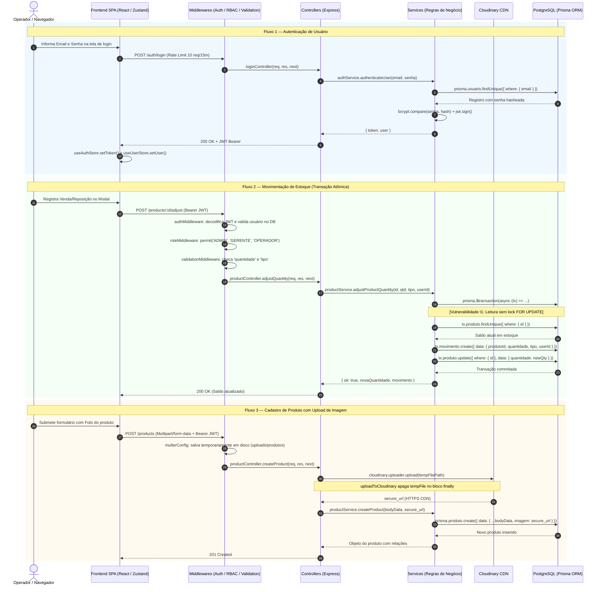

# 📑 RELATÓRIO TÉCNICO 02 — MAPEAMENTO DETALHADO DE MÓDULOS, ARQUIVOS E FUNÇÕES
## Projeto: Estoque.OS — Mapeamento Completo da Base de Código (Fase 1.3)
**Data da Auditoria:** 2026-11-08  
**Classificação do Projeto:** Nível de Refinamento `MEDIUM`  
**Responsável Técnico:** Senior Software Architect / Lead Auditor  
**Documento de Origem:** `PROMPT_MASTER_UNIFICADO.md`  

---

## 1. Mapeamento Arquitetural por Módulo

O sistema é composto por 6 módulos de negócio principais e 2 módulos transversais de infraestrutura e suporte:

```
[MÓDULO DE AUTENTICAÇÃO (Auth)] ───► Emite JWT (8h)
           ▲
           │ Valida Token em todas as requisições protegidas
           ▼
[MÓDULO DE USUÁRIOS (Users)] ◄────► [MÓDULO DE MOVIMENTAÇÕES (Movements)]
           ▲                                       ▲
           │ Vínculo Operacional                   │ Registro de Saldo
           ▼                                       ▼
[MÓDULO DE FORNECEDORES] ◄────► [MÓDULO DE PRODUTOS] ◄────► [MÓDULO DE CATEGORIAS]
```

---

## 2. Módulo de Autenticação (`Auth`)

### 2.1 Identificação do Módulo
- **Caminho:** `backend/src/routes/authRoutes.js`, `backend/src/controllers/authController.js`, `backend/src/services/authService.js`
- **Responsabilidade:** Credenciamento, geração e assinatura de tokens JWT e cadastro público de novos operadores com papel fixo.
- **Regra de Negócio Implementada:** `RN-001` (Credenciais obrigatórias e bcrypt hash), `RN-002` (Auto-registro sempre com papel `OPERADOR`), `RN-003` (Rate limiting de 10 tentativas por 15 min no login).
- **Problema que Resolve:** Elimina o risco de credenciais em texto puro, impede escalação horizontal de privilégios na criação de contas e mitiga ataques de força bruta.
- **De quem depende:** `prismaClient.js`, `bcryptjs`, `jsonwebtoken`, `logger.js`, `errorHandler.js`.
- **Quem depende dele:** Todas as rotas protegidas do backend (via token gerado) e o frontend ([`LoginForm.jsx`](file:///c:/Users/Ique%20Santana/Desktop/Mateus/vscode/projetos/portifolio/Estoque.OS/frontend/src/components/forms/LoginForm.jsx), [`RegisterForm.jsx`](file:///c:/Users/Ique%20Santana/Desktop/Mateus/vscode/projetos/portifolio/Estoque.OS/frontend/src/components/forms/RegisterForm.jsx), [`useAuthStore.js`](file:///c:/Users/Ique%20Santana/Desktop/Mateus/vscode/projetos/portifolio/Estoque.OS/frontend/src/store/useAuthStore.js)).

### 2.2 Arquivos e Funções do Módulo

#### A) [`backend/src/services/authService.js`](file:///c:/Users/Ique%20Santana/Desktop/Mateus/vscode/projetos/portifolio/Estoque.OS/backend/src/services/authService.js)
* **Imports:** `bcryptjs`, `jsonwebtoken`, `../config/prismaClient.js`, `../utils/errorHandler.js`.
* **Exportações:** `authenticateUser`, `registerUser`, `sanitizeUser`.

##### Função: `authenticateUser(email, senha)`
- **O que faz:** Valida as credenciais enviadas, consulta o usuário pelo e-mail, compara o hash bcrypt e assina o JWT com duração de 8 horas contendo `{ id, role }`.
- **Parâmetros:**
  - `email` (`string`, obrigatório, origem: `req.body.email` via controller).
  - `senha` (`string`, obrigatório, origem: `req.body.senha` via controller).
- **Validações:** Verifica se `email` e `senha` estão preenchidos (`AppError 400`). Verifica se o usuário existe (`AppError 401`) e se o hash confere (`AppError 401`).
- **Funções que chama:**
  - `→ prisma.usuario.findUnique({ where: { email } })`
  - `→ bcrypt.compare(senha, user.senha)`
  - `→ jwt.sign({ id, role }, JWT_SECRET, { expiresIn: '8h' })`
  - `→ authService#sanitizeUser(user)`
- **Quem a chama:** [`authController.js#loginController`](file:///c:/Users/Ique%20Santana/Desktop/Mateus/vscode/projetos/portifolio/Estoque.OS/backend/src/controllers/authController.js#L6).
- **Operações de Banco:** `SELECT` em `Usuario` por chave única `email`.
- **Efeitos Colaterais:** Nenhum no banco de dados.
- **Retorno:** `{ token: string, user: { id: number, nome: string, email: string, role: Role, imagem: string|null, createdAt: Date, updatedAt: Date } }`.
- **Erros Possíveis:** `AppError(400)` se campos ausentes; `AppError(401)` se email inexistente ou senha incorreta; `Error(500)` se `JWT_SECRET` for inválido.

##### Função: `registerUser({ nome, email, senha })`
- **O que faz:** Normaliza o e-mail (`trim().toLowerCase()`), valida ausência de cadastro prévio, gera hash da senha com salt 10 e insere o novo usuário fixando o papel em `OPERADOR`.
- **Parâmetros:**
  - `data.nome` (`string`, obrigatório, origem: `req.body.nome`).
  - `data.email` (`string`, obrigatório, origem: `req.body.email`).
  - `data.senha` (`string`, obrigatório, origem: `req.body.senha`).
- **Validações:** Verifica presença dos três campos (`AppError 400`) e unicidade de e-mail (`AppError 400`).
- **Funções que chama:**
  - `→ prisma.usuario.findUnique({ where: { email: normalizedEmail } })`
  - `→ bcrypt.hash(senha, 10)`
  - `→ prisma.usuario.create({ data: { nome, email, senha: hashed, role: 'OPERADOR' } })`
  - `→ authService#sanitizeUser(user)`
- **Quem a chama:** [`authController.js#registerController`](file:///c:/Users/Ique%20Santana/Desktop/Mateus/vscode/projetos/portifolio/Estoque.OS/backend/src/controllers/authController.js#L19).
- **Operações de Banco:** `SELECT` único e `INSERT INTO "Usuario"`.
- **Efeitos Colaterais:** Persistência de novo registro na tabela `Usuario`.
- **Retorno:** Objeto usuário limpo sem hash de senha.
- **Erros Possíveis:** `AppError(400)` se dados incompletos ou usuário já cadastrado.

##### Função: `sanitizeUser(user)`
- **O que faz:** Remove o atributo `senha` do objeto retornado do Prisma usando desestruturação.
- **Parâmetros:** `user` (`object|null`, obrigatório, origem: retorno do Prisma).
- **Retorno:** Objeto idêntico sem a chave `senha` (ou `null` se `user` for falsy).

#### B) [`backend/src/controllers/authController.js`](file:///c:/Users/Ique%20Santana/Desktop/Mateus/vscode/projetos/portifolio/Estoque.OS/backend/src/controllers/authController.js)
* **Funções:**
  * `loginController(req, res, next)`: Extrai `{ email, senha }`, chama `authService.authenticateUser`, emite log estruturado `User logged in successfully` e responde `200 JSON`.
  * `registerController(req, res, next)`: Extrai `{ nome, email, senha }`, chama `authService.registerUser`, emite log estruturado e responde `201 JSON`.

#### C) [`backend/src/routes/authRoutes.js`](file:///c:/Users/Ique%20Santana/Desktop/Mateus/vscode/projetos/portifolio/Estoque.OS/backend/src/routes/authRoutes.js)
* **Middlewares aplicados:** `loginLimiter` (10 req / 15 min), `validateRequest({ required: ['email', 'senha'] })` na rota `/login` e `validateRequest({ required: ['nome', 'email', 'senha'] })` na rota `/register`.

---

## 3. Módulo de Usuários e Perfis (`Users`)

### 3.1 Identificação do Módulo
- **Caminho:** `backend/src/routes/userRoutes.js`, `backend/src/controllers/userController.js`, `backend/src/services/userService.js`
- **Responsabilidade:** Controle de acesso, perfil do próprio operador autenticado (`/me`), dropdown otimizado (`/names`) e CRUD administrativo com proteção do último admin.
- **Regras de Negócio Implementadas:**
  - `RN-004`: Somente `ADMIN` pode gerenciar contas de terceiros (`POST /users`, `GET /users`, `PUT /users/:id`, `DELETE /users/:id`).
  - `RN-005`: O usuário autenticado não pode excluir a sua própria conta (`deleteUser` L192).
  - `RN-006`: O último administrador do sistema não pode ser excluído (`deleteUser` L202-207).
  - `RN-007`: Usuários com histórico de movimentações vinculadas não podem ser excluídos (`deleteUser` L209-214).
  - `RN-008`: Não-administradores não podem alterar seu próprio papel (role) em `updateMe` (L156-158).
- **Problema que Resolve:** Violações de integridade referencial (`P2003`), bloqueio acidental de acesso ao sistema (perda de todos os admins) e ataques de escalação de privilégios.
- **De quem depende:** `prismaClient.js`, `bcryptjs`, `cloudinaryConfig.js`, `sanitizers.js`, `multerConfig.js`, `authMiddleware.js`, `roleMiddleware.js`.
- **Quem depende dele:** `authMiddleware.js` (consulta de existência do usuário), `movementRoutes.js` (associação de operador), interface frontend (`Usuarios.jsx`, `Configuracoes.jsx`, `Sidebar.jsx`).

### 3.2 Arquivos e Funções do Módulo

#### A) [`backend/src/services/userService.js`](file:///c:/Users/Ique%20Santana/Desktop/Mateus/vscode/projetos/portifolio/Estoque.OS/backend/src/services/userService.js)

##### Função: `createUser(data, imagePath = null)`
- **O que faz:** Cria usuário por administrador. Gera hash da senha, associa imagem (se houver) e atribui role informada (ou fallback `OPERADOR`).
- **Parâmetros:** `data` (`{ nome, email, senha, role }`, obrigatório) e `imagePath` (`string|null`, opcional).
- **Validações:** Presença de `nome`, `email`, `senha` e unicidade de `email`.
- **Chamadas:** `→ prisma.usuario.findUnique`, `→ bcrypt.hash`, `→ prisma.usuario.create`, `→ sanitizers#sanitizeUser`.
- **Quem a chama:** [`userController.js#createUser`](file:///c:/Users/Ique%20Santana/Desktop/Mateus/vscode/projetos/portifolio/Estoque.OS/backend/src/controllers/userController.js#L13).
- **Operações de Banco:** `SELECT` e `INSERT INTO "Usuario"`.
- **Retorno:** Objeto sanitizado do usuário com ID gerado.

##### Função: `listUsers({ page = 1, limit = 10, search = "", role = "" })`
- **O que faz:** Retorna listagem paginada de usuários com filtros flexíveis (busca por nome ou ID, filtro por role).
- **Chamadas:** `→ Promise.all([ prisma.usuario.findMany, prisma.usuario.count ])`.
- **Quem a chama:** [`userController.js#listUsers`](file:///c:/Users/Ique%20Santana/Desktop/Mateus/vscode/projetos/portifolio/Estoque.OS/backend/src/controllers/userController.js#L50).
- **Retorno:** `{ data: User[], pagination: { page, limit, total, totalPages } }`.

##### Função: `getUserById(id)`
- **O que faz:** Busca registro único de usuário por ID numérico.
- **Chamadas:** `→ prisma.usuario.findUnique({ where: { id: Number(id) } })`.
- **Quem a chama:** [`userController.js#getUser`](file:///c:/Users/Ique%20Santana/Desktop/Mateus/vscode/projetos/portifolio/Estoque.OS/backend/src/controllers/userController.js#L74) e [`userController.js#getMe`](file:///c:/Users/Ique%20Santana/Desktop/Mateus/vscode/projetos/portifolio/Estoque.OS/backend/src/controllers/userController.js#L126).
- **Erros:** `AppError(404)` se não existir.

##### Função: `updateUser(id, data, newImagePath = null, removeImage = false)`
- **O que faz:** Atualiza dados de um usuário. Se uma nova senha for fornecida, gera hash bcrypt. Se houver substituição ou remoção de foto, exclui a imagem anterior no Cloudinary ou no disco local.
- **Chamadas:**
  - `→ prisma.usuario.findUnique`
  - `→ deleteFromCloudinary(imagePath)`
  - `→ fs.unlinkSync(localPath)` (se local)
  - `→ bcrypt.hash` (se nova senha informada)
  - `→ prisma.usuario.update`
- **Quem a chama:** [`userController.js#updateUser`](file:///c:/Users/Ique%20Santana/Desktop/Mateus/vscode/projetos/portifolio/Estoque.OS/backend/src/controllers/userController.js#L89) e [`userController.js#updateMe`](file:///c:/Users/Ique%20Santana/Desktop/Mateus/vscode/projetos/portifolio/Estoque.OS/backend/src/controllers/userController.js#L142).
- **Lacuna Identificada (`PROBLEMA`):** Não valida se a alteração do campo `role` está rebaixando (demoting) o último administrador remanescente do sistema.

##### Função: `deleteUser(id, requestingUserId = null)`
- **O que faz:** Exclui um usuário após validar 3 travas de segurança: autoexclusão, último administrador e movimentações existentes. Também apaga o avatar associado no Cloudinary.
- **Chamadas:**
  - `→ prisma.usuario.findUnique({ where: { id }, include: { _count: { select: { movimentos: true } } } })`
  - `→ prisma.usuario.count({ where: { role: "ADMIN" } })`
  - `→ deleteFromCloudinary(image)`
  - `→ prisma.usuario.delete({ where: { id } })`
- **Quem a chama:** [`userController.js#deleteUser`](file:///c:/Users/Ique%20Santana/Desktop/Mateus/vscode/projetos/portifolio/Estoque.OS/backend/src/controllers/userController.js#L112).
- **Erros:** `AppError(400)` se for a própria conta, se for o último admin, ou se possuir movimentações; `AppError(404)` se não existir.

#### B) [`backend/src/controllers/userController.js`](file:///c:/Users/Ique%20Santana/Desktop/Mateus/vscode/projetos/portifolio/Estoque.OS/backend/src/controllers/userController.js)
* **`getUserNames(req, res, next)`:** Executa `prisma.usuario.findMany({ select: { id: true, nome: true }, orderBy: { nome: 'asc' } })`. Responde com lista enxuta para dropdowns.
* **`updateMe(req, res, next)`:** Aplica guardrail explícito: se `req.user.role !== 'ADMIN'` e o cliente enviar `role` no corpo da requisição, lança `AppError('Acesso negado', 403)`. Se admin, permite alterar para `ADMIN`, `GERENTE` ou `OPERADOR`.

---

## 4. Módulo de Produtos e Catálogo (`Products`)

### 4.1 Identificação do Módulo
- **Caminho:** `backend/src/routes/productRoutes.js`, `backend/src/controllers/productController.js`, `backend/src/services/productService.js`
- **Responsabilidade:** Manutenção do catálogo de mercadorias, upload de fotos, estatísticas patrimoniais e atualização atômica de saldos via transação interativa.
- **Regras de Negócio Implementadas:**
  - `RN-009`: Criação e edição de catálogo restritas a `ADMIN` e `GERENTE`.
  - `RN-010`: Exclusão de produtos restrita a `ADMIN`.
  - `RN-011`: Ajuste de quantidade e geração de histórico permitido para `ADMIN`, `GERENTE` e `OPERADOR`.
  - `RN-012`: Uma saída (`VENDA`) não pode resultar em estoque negativo (`adjustProductQuantity` L194-200).
  - `RN-013`: Produtos com movimentações vinculadas não podem ser excluídos (`deleteProduct` L156-162).
- **De quem depende:** `prismaClient.js`, `cloudinaryConfig.js`, `multerConfig.js`, `logger.js`, `errorHandler.js`.
- **Quem depende dele:** `movementRoutes.js`, telas `Produtos.jsx`, `Dashboard.jsx`, `Pedidos.jsx`.

### 4.2 Arquivos e Funções do Módulo

#### A) [`backend/src/services/productService.js`](file:///c:/Users/Ique%20Santana/Desktop/Mateus/vscode/projetos/portifolio/Estoque.OS/backend/src/services/productService.js)

##### Função: `listProductsPaginated(filters = {})`
- **O que faz:** Constrói dinamicamente cláusula `where` com busca case-insensitive por nome (`contains`) e categoria (`categoriaId`). Limita paginação a no máximo 100 itens (`limitSafe = Math.min(Math.max(1, limit), 100)`), suportando parâmetro `limit: 'all'` sem paginação. Executa contagem e busca em paralelo (`Promise.all`).
- **Chamadas:** `→ Promise.all([ prisma.produto.findMany, prisma.produto.count ])`.
- **Quem a chama:** [`productController.js#listProducts`](file:///c:/Users/Ique%20Santana/Desktop/Mateus/vscode/projetos/portifolio/Estoque.OS/backend/src/controllers/productController.js#L10).
- **Retorno:** `{ data: Produto[], pagination: { page, limit, total, pages } }`.

##### Função: `getProductById(id)`
- **O que faz:** Obtém produto por ID incluindo joins com `categoria` e `fornecedor`.
- **Chamadas:** `→ prisma.produto.findUnique({ where: { id: Number(id) }, include: { categoria: true, fornecedor: true } })`.
- **Quem a chama:** [`productController.js#getProduct`](file:///c:/Users/Ique%20Santana/Desktop/Mateus/vscode/projetos/portifolio/Estoque.OS/backend/src/controllers/productController.js#L50).

##### Função: `createProduct(data, imagePath = null)`
- **O que faz:** Cria produto com parsing seguro de tipos (`preco: parseFloat(preco) || 0`, `quantidade: Number(quantidade) || 0`).
- **Chamadas:** `→ prisma.produto.create`.
- **Quem a chama:** [`productController.js#createProduct`](file:///c:/Users/Ique%20Santana/Desktop/Mateus/vscode/projetos/portifolio/Estoque.OS/backend/src/controllers/productController.js#L65).

##### Função: `updateProduct(id, data, newImagePath = null, removeImage = false)`
- **O que faz:** Atualiza dados e gerencia remoção de imagem antiga no Cloudinary ou disco local.
- **Chamadas:** `→ deleteFromCloudinary`, `→ prisma.produto.update`.
- **Quem a chama:** [`productController.js#updateProduct`](file:///c:/Users/Ique%20Santana/Desktop/Mateus/vscode/projetos/portifolio/Estoque.OS/backend/src/controllers/productController.js#L85).

##### Função: `deleteProduct(id)`
- **O que faz:** Valida se existem movimentações antes da exclusão (`prisma.movimento.count`). Exclui imagem no Cloudinary e apaga registro.
- **Chamadas:** `→ prisma.movimento.count`, `→ deleteFromCloudinary`, `→ prisma.produto.delete`.
- **Quem a chama:** [`productController.js#deleteProduct`](file:///c:/Users/Ique%20Santana/Desktop/Mateus/vscode/projetos/portifolio/Estoque.OS/backend/src/controllers/productController.js#L105).

##### Função: `adjustProductQuantity(id, quantidade, tipo, usuarioId, observacao = null)`
- **O que faz:** Ponto crítico do sistema. Normaliza tipo (`ENTRADA -> REPOSICAO`, `SAIDA -> VENDA`), abre uma transação interativa Prisma (`prisma.$transaction`), lê o saldo atual, valida suficiência de estoque para venda, cria o registro em `Movimento` e atualiza a quantidade do `Produto`.
- **Parâmetros:**
  - `id` (`number|string`, obrigatório, origem: `req.params.id`).
  - `quantidade` (`number`, obrigatório, origem: `req.body.quantidade`).
  - `tipo` (`string`, obrigatório, valores aceitos: `REPOSICAO`, `VENDA`, `ENTRADA`, `SAIDA`).
  - `usuarioId` (`number`, obrigatório, origem: `req.user.id`).
  - `observacao` (`string|null`, opcional, origem: `req.body.observacao`).
- **Chamadas:**
  - `→ prisma.$transaction(async (tx) => { ... })`
  - `→ tx.produto.findUnique({ where: { id } })`
  - `→ tx.movimento.create({ data: { produtoId, quantidade, tipo, usuarioId, observacao } })`
  - `→ tx.produto.update({ where: { id }, data: { quantidade: newQuantity } })`
- **Quem a chama:** [`productController.js#adjustQuantity`](file:///c:/Users/Ique%20Santana/Desktop/Mateus/vscode/projetos/portifolio/Estoque.OS/backend/src/controllers/productController.js#L122).
- **Lacuna Crítica Identificada (`PROBLEMA` - Catálogo I1):** Transação interativa sem trava de linha (`SELECT FOR UPDATE` ou atualização atômica `decrement`/`increment`). Sob concorrência no isolamento `Read Committed`, duas requisições simultâneas sofrem **Lost Update** ou geram saldo negativo.
- **Retorno:** `{ ok: true, novaQuantidade: number, movimento: Movimento }`.

##### Função: `getProductStats()`
- **O que faz:** Calcula o total de produtos cadastrados, contagem e amostra (take: 5) de itens com estoque baixo (`< 10`), e o valor financeiro do estoque através de agregação SQL nativa (`$queryRaw`) direta no PostgreSQL: `SELECT COALESCE(SUM(preco * quantidade), 0) AS "totalValue" FROM "Produto"`.
- **Chamadas:** `→ prisma.produto.count`, `→ prisma.produto.findMany`, `→ prisma.$queryRaw`.
- **Quem a chama:** [`productController.js#getProductStats`](file:///c:/Users/Ique%20Santana/Desktop/Mateus/vscode/projetos/portifolio/Estoque.OS/backend/src/controllers/productController.js#L36).
- **Retorno:** `{ total: number, lowStock: number, totalValue: number, lowStockList: Array<{ id, nome, quantidade }> }`.

##### Função: `countProducts()`
- **O que faz:** Executa `prisma.produto.count()`.
- **Quem a chama:** [`productController.js#countProducts`](file:///c:/Users/Ique%20Santana/Desktop/Mateus/vscode/projetos/portifolio/Estoque.OS/backend/src/controllers/productController.js#L23).

---

## 5. Módulo de Movimentações de Estoque (`Movements`)

### 5.1 Identificação do Módulo
- **Caminho:** `backend/src/routes/movementRoutes.js`, `backend/src/controllers/movementController.js`, `backend/src/services/movementService.js`
- **Responsabilidade:** Rastreamento do histórico operacional de reposição e vendas, filtragem por intervalos de datas e agregação analítica por operador.
- **Regras de Negócio Implementadas:**
  - `RN-014`: Apenas `ADMIN` e `GERENTE` têm permissão para acessar a rota agregada de auditoria de operadores (`/movements/user-stats`).
  - `RN-015`: Operadores têm acesso apenas à listagem geral do histórico (`/movements`).
- **Problema que Resolve:** Presta contas de quem movimentou cada mercadoria e quando, permitindo conciliação física e auditoria de inventário.
- **De quem depende:** `prismaClient.js`, `logger.js`, `errorHandler.js`.
- **Quem depende dele:** Telas `Movimentacoes.jsx`, `Pedidos.jsx`, `Dashboard.jsx`.

### 5.2 Arquivos e Funções do Módulo

#### A) [`backend/src/services/movementService.js`](file:///c:/Users/Ique%20Santana/Desktop/Mateus/vscode/projetos/portifolio/Estoque.OS/backend/src/services/movementService.js)

##### Função: `dateFromYMD(ymd, endOfDay = false)`
- **O que faz:** Converte string `YYYY-MM-DD` em `Date` manipulando componentes numéricos (ano, mês-1, dia), evitando distorções de fuso horário UTC do parser ISO.
- **Parâmetros:** `ymd` (`string`), `endOfDay` (`boolean`).

##### Função: `listMovementsPaginated(filters = {})`
- **O que faz:** Monta filtros dinâmicos no Prisma: ID específico, produto, tipo normalizado (`REPOSICAO`/`VENDA`), operador (`usuarioId`), data exata ou intervalo (`from`/`to`) e busca por nome de produto (join case-insensitive).
- **Parâmetros:** `filters` (`{ id, date, produtoId, from, to, order, page, limit, tipo, usuarioId, search }`).
- **Chamadas:** `→ Promise.all([ prisma.movimento.findMany, prisma.movimento.count ])`.
- **Quem a chama:** [`movementController.js#listMovements`](file:///c:/Users/Ique%20Santana/Desktop/Mateus/vscode/projetos/portifolio/Estoque.OS/backend/src/controllers/movementController.js#L10).
- **Retorno:** `{ data: Movimento[], pagination: { page, limit, total, pages } }`.

##### Função: `getUserStatsAggregated()`
- **O que faz:** Agregação SQL nativa de alta performance executando um único `SELECT ... GROUP BY` com `CASE WHEN` para total de vendas e reposições por usuário.
- **Chamadas:** `→ prisma.$queryRaw`.
- **Quem a chama:** **NENHUM COMPONENTE!** Código órfão/abandonado no service, pois o controller reimplementa a lógica via N+1 queries.

#### B) [`backend/src/controllers/movementController.js`](file:///c:/Users/Ique%20Santana/Desktop/Mateus/vscode/projetos/portifolio/Estoque.OS/backend/src/controllers/movementController.js)

##### Função: `getUserStats(req, res, next)`
- **O que faz:** Endpoint `/movements/user-stats`. Filtra por intervalo de datas e executa `prisma.movimento.groupBy` por `usuarioId`. Em seguida, para cada usuário retornado, executa duas queries adicionais: `prisma.usuario.findUnique` (para obter o nome) e `prisma.movimento.findMany` (para somar o valor financeiro das vendas em memória).
- **Lacuna Crítica Identificada (`PROBLEMA` - Catálogo I3):** N+1 queries disparadas via `Promise.all(stats.map(...))`. Para 100 operadores cadastrados, executa 201 consultas no banco de dados, ignorando a query única já escrita em `movementService.js#getUserStatsAggregated`.

---

## 6. Módulo de Categorias (`Categories`)

### 6.1 Identificação do Módulo
- **Caminho:** `backend/src/routes/categoryRoutes.js`, `backend/src/controllers/categoryController.js`, `backend/src/services/categoryService.js`
- **Responsabilidade:** Segmentação e agrupamento de produtos.
- **Regras de Negócio Implementadas:**
  - `RN-016`: Nomes de categoria são estritamente únicos no sistema (`createCategory` e `updateCategory`).
  - `RN-017`: Apenas `ADMIN` e `GERENTE` podem criar ou editar categorias.
  - `RN-018`: Apenas `ADMIN` pode excluir categorias.
  - `RN-019`: Categorias com produtos vinculados não podem ser excluídas (`deleteCategory` L66-71).
- **De quem depende:** `prismaClient.js`, `errorHandler.js`, `logger.js`.
- **Quem depende dele:** `productService.js`, `Categorias.jsx`, `Produtos.jsx`.

### 6.2 Arquivos e Funções do Módulo

#### A) [`backend/src/services/categoryService.js`](file:///c:/Users/Ique%20Santana/Desktop/Mateus/vscode/projetos/portifolio/Estoque.OS/backend/src/services/categoryService.js)
* **`listCategories()`:** Executa `prisma.categoria.findMany()` sem paginação (`PROBLEMA B10`).
* **`createCategory(nome)`:** Valida string não vazia, checa unicidade (`findUnique`) e executa `create`.
* **`updateCategory(id, nome)`:** Valida existência, valida se novo nome já pertence a outra categoria existente e executa `update`.
* **`deleteCategory(id)`:** Checa se existe (`findUnique`) com contagem de produtos (`_count.produtos`). Se `> 0`, lança `AppError 400`. Do contrário, deleta.
* **`countCategories()`:** Executa `prisma.categoria.count()`.

---

## 7. Módulo de Fornecedores (`Suppliers`)

### 7.1 Identificação do Módulo
- **Caminho:** `backend/src/routes/supplierRoutes.js`, `backend/src/controllers/supplierController.js`, `backend/src/services/supplierService.js`
- **Responsabilidade:** Gestão cadastral de fornecedores e parceiros, contatos e estatísticas de volume de reposição.
- **Regras de Negócio Implementadas:**
  - `RN-020`: Apenas `ADMIN` e `GERENTE` podem criar, editar ou excluir fornecedores.
  - `RN-021`: Todos os usuários autenticados podem consultar a lista e métricas de parceiros.
- **Problema que Resolve:** Centraliza contatos de compras e identifica parceiros críticos por volume.
- **Inconsistência Arquitetural Crítica Identificada (`PROBLEMA`):** Desacoplamento total entre controller e service. [`supplierController.js`](file:///c:/Users/Ique%20Santana/Desktop/Mateus/vscode/projetos/portifolio/Estoque.OS/backend/src/controllers/supplierController.js) não importa [`supplierService.js`](file:///c:/Users/Ique%20Santana/Desktop/Mateus/vscode/projetos/portifolio/Estoque.OS/backend/src/services/supplierService.js), reimplementando todas as chamadas `prisma.fornecedor.*` diretamente dentro dos métodos do controlador.

### 7.2 Funções e Agregação em Memória

#### A) [`backend/src/controllers/supplierController.js#getSupplierStats`](file:///c:/Users/Ique%20Santana/Desktop/Mateus/vscode/projetos/portifolio/Estoque.OS/backend/src/controllers/supplierController.js#L88-L132)
* **O que faz:** Busca todos os fornecedores do banco com include triplo: `fornecedor -> produtos -> movimentos`.
* **Processamento:** Itera sobre todos os produtos e todos os movimentos em JavaScript no processo Node.js (`forEach`), acumulando somatórios e encontrando o produto com maior movimentação (`topProduct`).
* **Lacuna Crítica Identificada (`PROBLEMA` - Catálogo I4):** Agregação pesada executada inteiramente na memória do servidor Node.js. À medida que o histórico de movimentações acumula dezenas de milhares de registros, essa chamada resultará em sobrecarga de I/O de rede com o banco e risco de indisponibilidade por esgotamento de memória (Out-Of-Memory / OOM).

---

## 8. Módulos Transversais: Middlewares, Infraestrutura e Frontend

### 8.1 Middlewares Globais do Backend
1. **[`authMiddleware.js`](file:///c:/Users/Ique%20Santana/Desktop/Mateus/vscode/projetos/portifolio/Estoque.OS/backend/src/middlewares/authMiddleware.js):**
   - Extrai token do cabeçalho `Authorization: Bearer <token>`.
   - Executa `jwt.verify(token, JWT_SECRET)`.
   - Executa `prisma.usuario.findUnique({ where: { id: payload.id } })` no banco de dados.
   - Anexa `req.user = { id, email, role }`.
   - *Nota de Performance:* Realiza uma consulta ao PostgreSQL a cada requisição HTTP autenticada.
2. **[`roleMiddleware.js`](file:///c:/Users/Ique%20Santana/Desktop/Mateus/vscode/projetos/portifolio/Estoque.OS/backend/src/middlewares/roleMiddleware.js):**
   - Fábrica `permit(...allowedRoles)`.
   - Retorna `AppError('Não autenticado', 401)` se `!req.user`.
   - Retorna `AppError('Acesso negado', 403)` se `!allowedRoles.includes(req.user.role)`.
3. **[`validationMiddleware.js`](file:///c:/Users/Ique%20Santana/Desktop/Mateus/vscode/projetos/portifolio/Estoque.OS/backend/src/middlewares/validationMiddleware.js):**
   - Fábrica `validateRequest(schema)`.
   - Valida campos obrigatórios (`schema.required`).
   - Valida regex de email, valores numéricos de `preco >= 0` e `quantidade >= 0`.
4. **[`requestLogger.js`](file:///c:/Users/Ique%20Santana/Desktop/Mateus/vscode/projetos/portifolio/Estoque.OS/backend/src/middlewares/requestLogger.js):**
   - Intercepta `res.on('finish')` para calcular a latência em milissegundos (`durationMs`) e registra com Pino.
5. **[`errorHandler.js`](file:///c:/Users/Ique%20Santana/Desktop/Mateus/vscode/projetos/portifolio/Estoque.OS/backend/src/utils/errorHandler.js):**
   - Captura exceções unificadas via Express middleware `(err, req, res, next)`.
   - Formata resposta HTTP com `{ error: message }` e status code correspondente.

### 8.2 Frontend: Stores Zustand e Clientes HTTP
1. **[`useAuthStore.js`](file:///c:/Users/Ique%20Santana/Desktop/Mateus/vscode/projetos/portifolio/Estoque.OS/frontend/src/store/useAuthStore.js):**
   - Gerencia `token` JWT com persistência em `localStorage['auth-token']`.
2. **[`useUserStore.js`](file:///c:/Users/Ique%20Santana/Desktop/Mateus/vscode/projetos/portifolio/Estoque.OS/frontend/src/store/useUserStore.js):**
   - Gerencia objeto `user` autenticado com persistência em `localStorage['user-data']`.
   - *Risco de Dessincronização:* Armazenamento em duas chaves distintas de `localStorage` sem atomicidade na limpeza de sessão.
3. **[`apiClient.js`](file:///c:/Users/Ique%20Santana/Desktop/Mateus/vscode/projetos/portifolio/Estoque.OS/frontend/src/services/api/apiClient.js):**
   - Extrai token hidratado do `localStorage['auth-token']`.
   - Injeta cabeçalho `Authorization: Bearer <token>`.
   - Trata erros HTTP (`401`, `403`, `404`, `500`) padronizando mensagens amigáveis.
4. **[`EditarItem.jsx`](file:///c:/Users/Ique%20Santana/Desktop/Mateus/vscode/projetos/portifolio/Estoque.OS/frontend/src/components/forms/EditarItem.jsx):**
   - Componente modal polimórfico de criação e edição.
   - *Lacuna Identificada (`PROBLEMA B9`):* Não utiliza o `apiClient.js`, disparando chamadas `fetch` diretas com headers montados manualmente.

---

## 9. Mapa de Chamadas entre Módulos (Diagrama Mermaid)

O diagrama abaixo detalha a cadeia de execução real de ponta a ponta:



