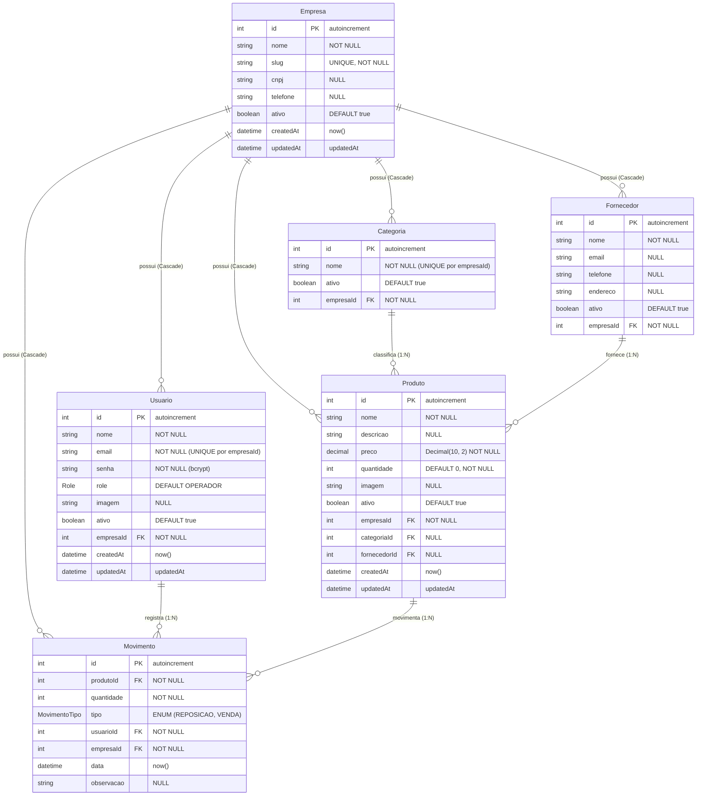

# 📑 RELATÓRIO TÉCNICO 04 — MODELS, ESTRUTURAS DE DADOS E BANCO DE DADOS
## Projeto: Estoque.OS — Modelagem Multi-Tenant e Camada de Persistência (Sincronizado Fase G)
**Data da Atualização:** 2026-11-10  
**Branch Auditada:** `feature/multitenant`  
**Responsável Técnico:** Senior Software Architect / Lead Auditor  

---

## 1. Topologia do Banco de Dados e ORM

- **SGBD Primário:** PostgreSQL (hospedado na nuvem via **Neon Database**, AWS `us-east-1`).
- **Mecanismo de Conexão:** String de conexão via variável `DATABASE_URL` em `backend/.env` (com suporte a pooler PgBouncer gerenciado pelo Neon quando configurada na URL).
- **ORM / Query Builder:** **Prisma ORM v6.16.2** (`@prisma/client`).
- **Arquivo de Esquema:** [`backend/prisma/schema.prisma`](file:///c:/Users/Ique%20Santana/Desktop/Mateus/vscode/projetos/portifolio/Estoque.OS/backend/prisma/schema.prisma).
- **Estratégia de Migrações:** **5 migrações versionadas** em `backend/prisma/migrations/`:
  1. `20250918051748_init`
  2. `20251012223132_add_field_imagem_usuario`
  3. `20260601063115_upd_tabela_fornecedores`
  4. `20261022_alter_enum_reposicao_venda`
  5. `20261110_multitenant_softdelete` *(Introdução do model `Empresa`, chaves `empresaId`, unicidades compostas por loja, `ativo Boolean` e índices compostos multi-tenant)*

---

## 2. Diagrama Entidade-Relacionamento (ERD Real — `schema.prisma`)

---

## 3. Mapeamento Detalhado das Entidades e Índices

### 3.1 Entidade `Empresa` (`schema.prisma` L10–L27)
* **Finalidade:** Raiz do isolamento multi-tenant. Cada loja cadastrada (pelo `/auth/register` ou seed) ganha um `id` e `slug` próprios.
* **Campos:** `id`, `nome`, `slug (@unique)`, `cnpj?`, `telefone?`, `ativo (Boolean, @default(true))`, `createdAt`, `updatedAt`.
* **Índices:** `@@index([slug])`, `@@index([ativo])`. *(Nota: `slug` já recebe índice único automático do `@unique`, tornando `@@index([slug])` redundante).*

### 3.2 Entidade `Usuario` (`schema.prisma` L29–L47)
* **Campos:** `id`, `nome`, `email`, `senha` (hash Bcrypt cost 10), `role` (`ADMIN | GERENTE | OPERADOR`), `imagem?`, `ativo (Boolean, @default(true))`, `empresaId (Int FK -> Empresa.id onDelete: Cascade)`, `createdAt`, `updatedAt`.
* **Restrições e Índices:**
  - `@@unique([empresaId, email])`: Permite que a mesma pessoa física trabalhe em lojas diferentes com o mesmo e-mail, impedindo apenas duplicidade dentro da mesma loja.
  - `@@index([empresaId, email])`, `@@index([empresaId, role])`, `@@index([empresaId, ativo])`. *(Obs.: `@@index([empresaId, email])` é redundante em B-Tree com `@@unique([empresaId, email])`)*.

### 3.3 Entidade `Categoria` (`schema.prisma` L49–L60)
* **Campos:** `id`, `nome`, `ativo (Boolean, @default(true))`, `empresaId (Int FK -> Empresa.id onDelete: Cascade)`.
* **Restrições e Índices:** `@@unique([empresaId, nome])`, `@@index([empresaId])`, `@@index([empresaId, ativo])`.
* **Lacuna Remanescente:** Ainda não possui campos `createdAt`/`updatedAt`.

### 3.4 Entidade `Fornecedor` (`schema.prisma` L62–L75)
* **Campos:** `id`, `nome`, `email?`, `telefone?`, `endereco?`, `ativo (Boolean, @default(true))`, `empresaId (Int FK -> Empresa.id onDelete: Cascade)`.
* **Índices:** `@@index([empresaId])`, `@@index([empresaId, ativo])`.
* **Lacunas Remanescentes:** Não há restrição `@@unique([empresaId, nome])` nem `createdAt`/`updatedAt`.

### 3.5 Entidade `Produto` (`schema.prisma` L77–L100)
* **Campos:** `id`, `nome`, `descricao?`, `preco` (`Decimal @db.Decimal(10, 2)` — erro histórico `I7` de `Float` **eliminado na Fase C**), `quantidade (Int @default(0))`, `imagem?`, `ativo (Boolean, @default(true))`, `empresaId (Int FK onDelete: Cascade)`, `categoriaId?`, `fornecedorId?`, `createdAt`, `updatedAt`.
* **Índices Compostos Multi-Tenant:**
  - `@@index([empresaId, ativo])`
  - `@@index([empresaId, categoriaId, quantidade])`
  - `@@index([empresaId, fornecedorId])`
  - `@@index([empresaId, quantidade])`
  - `@@index([empresaId, nome])`

### 3.6 Entidade `Movimento` (`schema.prisma` L102–L118)
* **Campos:** `id`, `produtoId`, `quantidade`, `tipo` (`REPOSICAO | VENDA`), `usuarioId`, `empresaId (Int FK onDelete: Cascade)`, `data (@default(now()))`, `observacao?`.
* **Índices Compostos Multi-Tenant:**
  - `@@index([empresaId, usuarioId])`
  - `@@index([empresaId, produtoId, data])`
  - `@@index([empresaId, data])`

---

## 4. Avaliação Arquitetural e Integridade Referencial

1. **Multi-Tenancy Shared Database, Shared Schema:** Todas as tabelas de negócio possuem `empresaId` indexado como coluna líder dos índices compostos, garantindo varreduras eficientes no PostgreSQL por estabelecimento.
2. **Soft Delete vs. Cascata:** Enquanto a exclusão de uma `Empresa` limpa os filhos em cascata (`onDelete: Cascade`), as operações cotidianas em `Usuario`, `Produto`, `Categoria` e `Fornecedor` verificam vínculos (`_count.movimentos` ou `_count.produtos`) e aplicam **Soft Delete automático** (`ativo = false`), preservando 100% do livro-razão (`Movimento`).

---

## 5. Estado Atual das Consultas Críticas (Pós-Fases A–G)

| Consulta / Endpoint | Implementação Atual | Diagnóstico |
| :--- | :--- | :--- |
| **Patrimônio (`/products/stats`)** | `SELECT COALESCE(SUM(preco * quantidade), 0) ... WHERE "empresaId" = ... AND "ativo" = true` | `OTIMIZADO` (`Decimal(10,2)` exato no PostgreSQL) |
| **Ajuste de Estoque (`/products/:id/adjust`)** | `prisma.$transaction` + `SELECT ... FOR UPDATE WHERE id AND "empresaId"` | `CORRIGIDO / TESTADO` (Serializado sem Lost Update) |
| **Estatísticas de Equipe (`/movements/user-stats`)** | SQL `$queryRaw` único com `JOIN` e filtro `u."empresaId"` | `CORRIGIDO / TESTADO` (N+1 eliminado) |
| **Métricas de Fornecedores (`/suppliers/stats`)** | SQL `$queryRaw` único com `LEFT JOIN` filtrando `ativo = true` | `CORRIGIDO / TESTADO` (Zero processamento N+1 em Node) |
| **Importação em Lote (`POST /products/import`)** | Validação completa + `prisma.$transaction` (`create` categorias/fornecedores + `createMany` produtos) | `IMPLEMENTADO / TESTADO` (Atômico por loja) |
| **Listagem (`/movements?limit=all`)** | `prisma.movimento.findMany` paginado ou `'all'` para gráficos | `MELHORÁVEL` (Futuramente substituir `'all'` nos gráficos por endpoint agregado SQL) |
