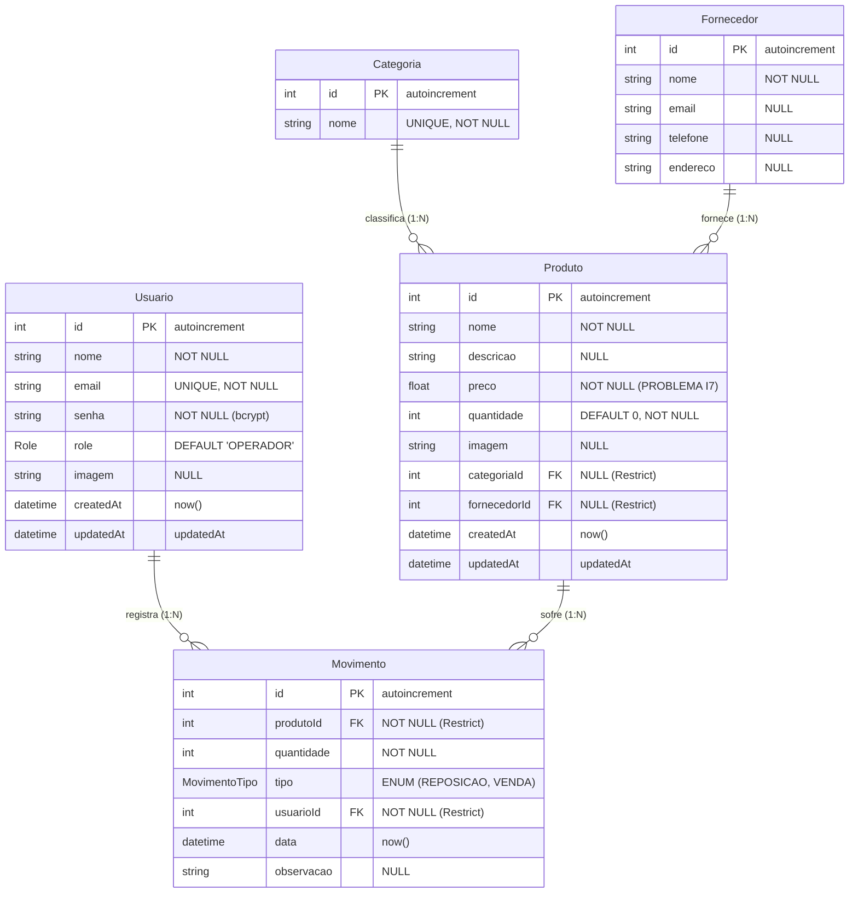

# 📑 RELATÓRIO TÉCNICO 04 — MODELS, ESTRUTURAS DE DADOS E BANCO DE DADOS
## Projeto: Estoque.OS — Mapeamento e Diagnóstico da Camada de Persistência (Fase 1.5 e 1.6)
**Data da Auditoria:** 2026-11-08  
**Classificação do Projeto:** Nível de Refinamento `MEDIUM`  
**Responsável Técnico:** Senior Software Architect / Lead Auditor  
**Documento de Origem:** `PROMPT_MASTER_UNIFICADO.md`  

---

## 1. Topologia do Banco de Dados e ORM

- **SGBD Primário:** PostgreSQL (hospedado na nuvem no **Neon Database**, AWS us-east-1).
- **Mecanismo de Conexão:** Connection Pooler gerenciado pelo Neon via endpoint TCP PgBouncer (`ep-bold-poetry-...-pooler.c-2.us-east-1.aws.neon.tech`).
- **ORM / Query Builder:** **Prisma ORM v6.16.2** (`@prisma/client`).
- **Arquivo de Configuração de Esquema:** [`backend/prisma/schema.prisma`](file:///c:/Users/Ique%20Santana/Desktop/Mateus/vscode/projetos/portifolio/Estoque.OS/backend/prisma/schema.prisma).
- **Estratégia de Migrações:** Prisma Migrate (`backend/prisma/migrations/`), com 4 migrações versionadas registradas.

---

## 2. Diagrama Entidade-Relacionamento (ERD Real)

O diagrama abaixo reflete com fidelidade matemática a modelagem física atual no PostgreSQL:

---

## 3. Mapeamento Detalhado das Entidades e Campos

### 3.1 Entidade `Usuario`
* **Tabela Física:** `"Usuario"`
* **Finalidade:** Armazena identidades, credenciais criptografadas e papéis operacionais.
* **Campos:**
  - `id` (`Int`, PK, `@default(autoincrement())`): Identificador sequencial.
  - `nome` (`String`, obrigatório): Nome completo de exibição.
  - `email` (`String`, obrigatório, `@unique`): Chave única natural para autenticação.
  - `senha` (`String`, obrigatório): Hash criptográfico Bcrypt (salt cost 10).
  - `role` (`Enum Role`: `ADMIN`, `GERENTE`, `OPERADOR`, `@default(OPERADOR)`): Papel para controle de acesso RBAC.
  - `imagem` (`String?`, opcional): URL segura HTTPS da foto hospedada no Cloudinary (ou caminho relativo em `/uploads/usuarios/`).
  - `createdAt` (`DateTime`, `@default(now())`): Timestamp de auditoria de criação.
  - `updatedAt` (`DateTime`, `@updatedAt`): Timestamp de última alteração.
* **Índices Definidos:**
  - `@@index([email])`: **Índice redundante** (`PROBLEMA I6`). O PostgreSQL já cria automaticamente um índice B-Tree exclusivo para campos `@unique`. O índice explícito ocupa espaço desnecessário e sobrecarrega inserções.
  - `@@index([role])`: Índice B-Tree para agilizar o filtro administrativo por cargo em `GET /users?role=OPERADOR`.

### 3.2 Entidade `Categoria`
* **Tabela Física:** `"Categoria"`
* **Finalidade:** Organização taxonômica dos produtos no catálogo.
* **Campos:**
  - `id` (`Int`, PK, `@default(autoincrement())`).
  - `nome` (`String`, obrigatório, `@unique`): Nome da categoria (ex.: "Periféricos", "Monitores").
* **Lacunas Identificadas:**
  - Ausência de campos de auditoria temporal (`createdAt`, `updatedAt`).

### 3.3 Entidade `Fornecedor`
* **Tabela Física:** `"Fornecedor"`
* **Finalidade:** Dados cadastrais dos parceiros comerciais distribuidores.
* **Campos:**
  - `id` (`Int`, PK, `@default(autoincrement())`).
  - `nome` (`String`, obrigatório): Razão social ou nome fantasia.
  - `email` (`String?`, opcional): E-mail corporativo.
  - `telefone` (`String?`, opcional): Contato telefônico.
  - `endereco` (`String?`, opcional): Endereço físico.
* **Lacunas Identificadas:**
  - Sem restrição de unicidade em `nome` ou `email` (permite fornecedores duplicados).
  - Sem campos de timestamp de auditoria (`createdAt`, `updatedAt`).

### 3.4 Entidade `Produto`
* **Tabela Física:** `"Produto"`
* **Finalidade:** Mercadorias registradas para controle físico e financeiro.
* **Campos:**
  - `id` (`Int`, PK, `@default(autoincrement())`).
  - `nome` (`String`, obrigatório): Nome comercial do item.
  - `descricao` (`String?`, opcional): Detalhes técnicos.
  - `preco` (`Float`, obrigatório): Preço unitário de venda/aquisição.  
    > **⚠️ FALHA CRÍTICA DE MODELAGEM (`PROBLEMA I7`):** Uso do tipo **`Float` (ponto flutuante IEEE 754 de precisão dupla)** para representação de dinheiro. Ponto flutuante binário acumula erros de arredondamento em somatórios e multiplicações financeiras (ex.: `0.1 + 0.2 = 0.30000000000000004`). O correto e mandatório para finanças é **`Decimal(10, 2)`** no PostgreSQL e Prisma.
  - `quantidade` (`Int`, obrigatório, `@default(0)`): Saldo físico disponível em estoque.
  - `imagem` (`String?`, opcional): URL no Cloudinary ou path local.
  - `categoriaId` (`Int?`, opcional, FK referenciando `Categoria.id`).
  - `fornecedorId` (`Int?`, opcional, FK referenciando `Fornecedor.id`).
  - `createdAt` / `updatedAt` (`DateTime`).
* **Índices Definidos:**
  - `@@index([categoriaId])`: Otimiza joins e filtros por categoria.
  - `@@index([fornecedorId])`: Otimiza joins por fornecedor.
  - `@@index([quantidade])`: Otimiza a consulta de baixo estoque (`quantidade < 10`).
  - `@@index([nome])`: Índice B-Tree para buscas exatas e prefixadas. *Nota:* Para buscas parciais (`contains` case-insensitive), o PostgreSQL realiza *Seq Scan* a menos que se utilize extensão `pg_trgm` com índice GIN.

### 3.5 Entidade `Movimento`
* **Tabela Física:** `"Movimento"`
* **Finalidade:** Livro-razão imutável de todas as entradas e saídas de estoque.
* **Campos:**
  - `id` (`Int`, PK, `@default(autoincrement())`).
  - `produtoId` (`Int`, obrigatório, FK referenciando `Produto.id`).
  - `quantidade` (`Int`, obrigatório): Unidades movimentadas (sempre inteiro positivo).
  - `tipo` (`Enum MovimentoTipo`: `REPOSICAO`, `VENDA`): Tipo da transação.
  - `usuarioId` (`Int`, obrigatório, FK referenciando `Usuario.id`): Operador responsável.
  - `data` (`DateTime`, `@default(now())`): Timestamp da ocorrência.
  - `observacao` (`String?`, opcional): Justificativa operacional, número de pedido ou lote.
* **Índices Definidos:**
  - `@@index([usuarioId])`: Otimiza filtros por operador.
  - `@@index([produtoId])`: Otimiza histórico por produto.
  - `@@index([data])`: Otimiza ordenação e filtros de intervalo temporal.
* **Lacuna de Índices Compostos:** O sistema filtra frequentemente por `[data, tipo]` e `[usuarioId, data]`. A ausência de um índice composto faz com que o PostgreSQL combine múltiplos Bitmap Index Scans ou recorra a ordenação custosa em disco.

---

## 4. Avaliação Arquitetural do Banco de Dados

### 4.1 Normalização e Cardinalidade
* O modelo encontra-se na **3ª Forma Normal (3FN)**: não há atributos multivalorados, todas as chaves dependem diretamente da chave primária e não há dependências transitivas.
* A separação entre `Produto` e `Movimento` garante que o histórico de movimentações permaneça imutável mesmo se o saldo atual do produto for alterado.
* Cardinalidades adequadas: `Categoria (1) ── (N) Produto`, `Fornecedor (1) ── (N) Produto`, `Produto (1) ── (N) Movimento`, `Usuario (1) ── (N) Movimento`.

### 4.2 Integridade Referencial e Comportamento `ON DELETE`
* **Comportamento Padrão no Prisma:** Todas as chaves estrangeiras (`categoriaId`, `fornecedorId`, `produtoId`, `usuarioId`) estão configuradas sem cláusula explícita `onDelete: Cascade` ou `onDelete: SetNull`.
* Por padrão no Prisma/Postgres, o comportamento é **`Restrict` / `NoAction`**.
* O backend compensa essa restrição com verificações preventivas em nível de serviço:
  - `deleteUser`: verifica `user._count.movimentos > 0` antes de deletar (`userService.js` L209).
  - `deleteProduct`: verifica `movementsCount > 0` antes de deletar (`productService.js` L156).
  - `deleteCategory`: verifica `category._count.produtos > 0` antes de deletar (`categoryService.js` L66).
  - `deleteSupplier`: verifica `supplier._count.produtos > 0` antes de deletar (`supplierService.js` L56).
* **Diagnóstico:** A integridade referencial está preservada contra quebras e registros órfãos.

---

## 5. Mapeamento das Consultas e Identificação de Gargalos

| Consulta / Endpoint | Implementação | Padrão de Execução no PostgreSQL | Diagnóstico e Severidade |
| :--- | :--- | :--- | :--- |
| **Cálculo Patrimonial (`/products/stats`)** | `SELECT COALESCE(SUM(preco * quantidade), 0) FROM "Produto"` | **Index Scan / Aggregation nativa** | `IMPLEMENTADO (verificado)` — Alta performance, executado no banco com baixo uso de memória. |
| **Baixo Estoque (`/products/stats`)** | `prisma.produto.findMany({ where: { quantidade: { lt: 10 } }, take: 5 })` | **Index Scan** no índice `quantidade` | `IMPLEMENTADO (verificado)` — Rápido e limitado. |
| **Ajuste de Estoque (`/products/:id/adjust`)** | Transação interativa: `tx.findUnique` → cálculo em memória → `tx.update` | **Read Committed sem lock de linha** | `PROBLEMA I1` — Risco de Lost Update e saldo negativo sob concorrência simultânea. |
| **Estatísticas de Operador (`/movements/user-stats`)** | `groupBy` + `Promise.all(findUnique + findMany)` | **N+1 queries sequenciais repetidas** | `PROBLEMA I3` — Gera 2N+1 roundtrips de rede ao PostgreSQL. |
| **Fluxo por Fornecedor (`/suppliers/stats`)** | `findMany({ include: { produtos: { include: { movimentos } } } })` | **Join triplo total sem paginação** | `PROBLEMA I4` — Agregação de todo o banco executada na CPU/memória do Node.js. |
| **Gráficos de Movimentações (`/movements?limit=all`)** | `prisma.movimento.findMany({ include: { produto, usuario } })` | **Full Table Scan sem teto** | `PROBLEMA I4 / B10` — Carga desnecessária de toda a base a cada navegação de tela. |
| **Listagem de Categorias e Fornecedores** | `prisma.categoria.findMany()` e `prisma.fornecedor.findMany()` | **Seq Scan sem paginação** | `PROBLEMA B10` — Ausência de `skip`/`take` nas listagens auxiliares. |

---

## 6. Conclusão Técnica sobre o Banco de Dados: Manter ou Modificar?

### Veredito: **MODIFICAR PONTUALMENTE**

1. **Alterar tipo do campo `Produto.preco` de `Float` para `Decimal(10, 2)`:**
   - *Justificativa:* Erradicar erros de precisão monetária acumulados em cálculos de faturamento e montante patrimonial.
2. **Eliminar índice redundante `@@index([email])` em `Usuario`:**
   - *Justificativa:* O constraint `@unique` já gera índice B-Tree equivalente.
3. **Criar índices compostos em `Movimento`:**
   - `@@index([data, tipo])` e `@@index([usuarioId, data])` para acelerar os relatórios temporais do Dashboard e da tela de Movimentações.
4. **Adicionar campos de auditoria (`createdAt`, `updatedAt`) em `Categoria` e `Fornecedor`:**
   - *Justificativa:* Conformidade corporativa e rastreabilidade temporal.
5. **Introduzir `SELECT FOR UPDATE` ou atualização atômica (`decrement`/`increment`) em `adjustProductQuantity`:**
   - *Justificativa:* Garantir atomicidade e consistência estrita (ACID) sob múltiplos operadores simultâneos (+100 usuários).

