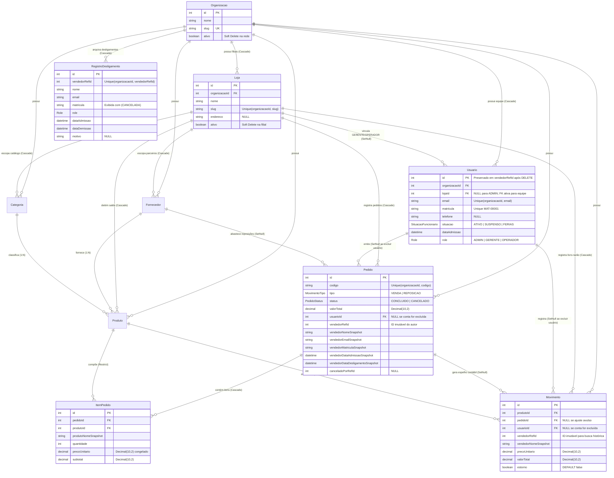

# 📑 RELATÓRIO TÉCNICO 04 — MODELS, ESTRUTURAS DE DADOS E BANCO DE DADOS
## Projeto: Estoque.OS — Modelagem Multi-Organização, Multipedidos & Preservação Histórica (Fase H)
**Data da Atualização:** 2026-11-10  
**Branch Auditada:** `main` (sincronizada com `feature/multitenant`)  

---

## 1. Topologia do Banco de Dados e Histórico de Migrações `[IMPLEMENTADO (verificado)]`

- **SGBD Primário:** PostgreSQL (Neon Cloud Database).
- **ORM:** Prisma ORM (`@prisma/client` `^6.16.2`, client gerado em v6.19.2 na última checagem).
- **Schema Oficial:** [`backend/prisma/schema.prisma`](file:///c:/Users/Ique%20Santana/Desktop/Mateus/vscode/projetos/portifolio/Estoque.OS/backend/prisma/schema.prisma).
- **9 Migrações Versionadas em `backend/prisma/migrations/`:**
  1. `20250918051748_init` — Esquema base inicial.
  2. `20251012223132_add_field_imagem_usuario` — Avatar em usuários.
  3. `20260601063115_upd_tabela_fornecedores` — Expansão de fornecedores.
  4. `20261022_alter_enum_reposicao_venda` — Enum canônico `REPOSICAO` / `VENDA`.
  5. `20261110_multitenant_softdelete` — Introdução de `Empresa` + `ativo`.
  6. `20261110_organizacao_multipedidos` — Evolução de `Empresa` → `Organizacao` + `Loja` (com backfill seguro preservando IDs), criação de `PedidoStatus`, `Pedido` e `ItemPedido`, remoção de `Usuario.ativo`, e inclusão de `vendedorRefId`, `vendedorNomeSnapshot`, `vendedorEmailSnapshot`, `precoUnitario`, `valorTotal`, `estorno` e `pedidoId` em `Movimento`.
  7. `20261110_pedido_comprovantes` — Inclusão de `formaPagamento`, `statusPagamento`, `comprovanteCodigo`, `comprovanteUrl` e `recebidoPor` em `Pedido`.
  8. `20261110_matricula_situacao_rh` — Inclusão do enum `SituacaoFuncionario` (`ATIVO` | `SUSPENSO` | `FERIAS`), `matricula` única (`MAT-00001`), `telefone`, `situacao`, `dataAdmissao` em `Usuario` e snapshots `vendedorMatriculaSnapshot`, `vendedorDataAdmissaoSnapshot` e `vendedorDataDesligamentoSnapshot` em `Pedido` e `Movimento`.
  9. `20261110_registro_desligamento` — Criação da tabela **`RegistroDesligamento`** (`vendedorRefId`, `matricula`, `dataAdmissao`, `dataDemissao`, `motivo`, `lojaNome`, com backfill dos históricos existentes) para listar/filtrar ex-funcionários em `/dashboard/usuarios` mantendo a exclusão física em `Usuario`.

---

## 2. Diagrama Entidade-Relacionamento Real (`schema.prisma`)

---

## 3. Decisões Críticas de Integridade & Índices `[IMPLEMENTADO (verificado)]`

1. **Exclusão Física de `Usuario` Sem Quebrar Histórico:**
   - Diferente de `Produto`, `Categoria`, `Fornecedor` e `Loja` (que usam `ativo: Boolean` pois itens podem ser descontinuados), `Usuario` foi projetado **sem `ativo`**.
   - Quando um `Usuario` é excluído (`DELETE /users/:id`), as chaves estrangeiras `Pedido.usuarioId` e `Movimento.usuarioId` possuem `onDelete: SetNull`, tornando-se `NULL`, enquanto `vendedorRefId` (inteiro obrigatório), `vendedorNomeSnapshot` e `vendedorEmailSnapshot` permanecem intactos e indexados (`@@index([organizacaoId, vendedorRefId, createdAt])` em `Pedido` e `@@index([organizacaoId, vendedorRefId, data])` em `Movimento`).
2. **Precisão Monetária Congelada (`Decimal(10, 2)`):**
   - `Produto.preco`, `Pedido.valorTotal`, `ItemPedido.precoUnitario`, `ItemPedido.subtotal`, `Movimento.precoUnitario` e `Movimento.valorTotal` utilizam `@db.Decimal(10, 2)` (`numeric(10,2)`), garantindo que reajustes futuros no preço de um produto nunca alterem o faturamento histórico passado.
3. **Seed Realista Multi-Organização (`backend/prisma/seed.js`):**
   - **Organização 1 — `Grupo TechStock Varejo` (`grupo-techstock`):** Lojas `TechStock Centro` e `TechStock Shopping`, `ADMIN` (`admin@techstock.com`), 2 `GERENTE`s, `OPERADOR`es ativos (`op1`..`op4`), **1 colaborador `SUSPENSO` (`Carlos Henrique`)**, **1 colaboradora em `FERIAS` (`Juliana Costa`)** e **1 ex-funcionário fisicamente excluído (`Marcos Antunes`)** cuja matrícula permanece auditável como `(CANCELADA)`.
   - **Organização 2 — `CyberForge Geek Store` (`cyberforge-geek`):** Loja `CyberForge Matriz`, `admin@cyberforge.com`, `gerente1@cyberforge.com`, `op1/op2@cyberforge.com` e `peter.susp@cyberforge.com` (`SUSPENSO`). Senha unificada: `Password123!`.
   - Gera **12 meses** de multipedidos de compra e venda, cancelamento/estorno demonstrativo no mês atual e SKUs inativos com histórico (`Cabo VGA Analógico Legado`, `Hub USB 2.0 Antigo`, `Box Edição Limitada Convenção 2024`).
