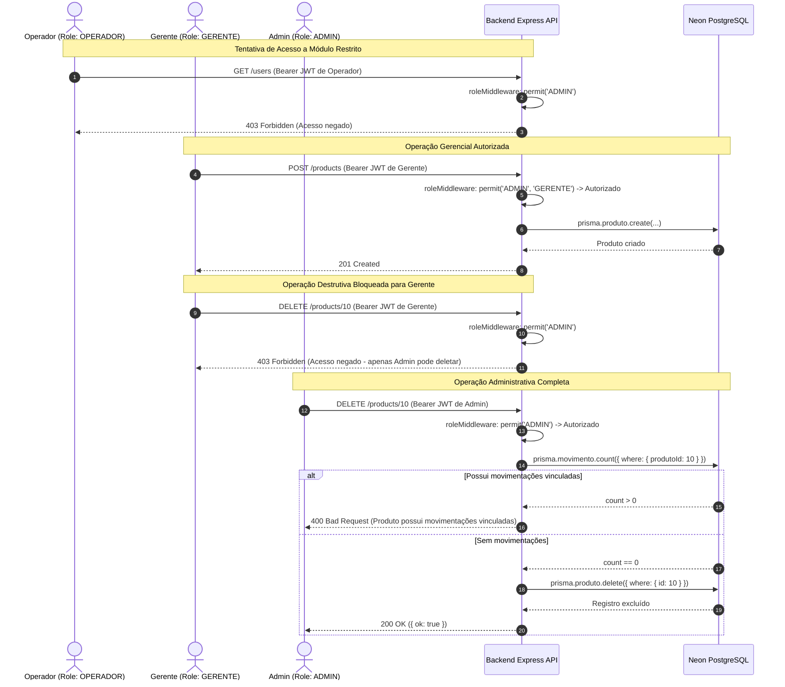

# 📑 RELATÓRIO TÉCNICO 05 — JORNADAS DE USO: O SISTEMA EM FUNCIONAMENTO
## Projeto: Estoque.OS — Cronogramas Passo a Passo por Perfil de Usuário (Fase 2)
**Data da Auditoria:** 2026-11-08  
**Classificação do Projeto:** Nível de Refinamento `MEDIUM`  
**Responsável Técnico:** Senior Software Architect / Lead Auditor  
**Documento de Origem:** `PROMPT_MASTER_UNIFICADO.md`  

---

## 1. Perfis de Usuário no Sistema

O **Estoque.OS** possui três perfis de acesso bem definidos na modelagem e autorização RBAC:
1. **`OPERADOR`:** Operador de chão de fábrica, conferente ou caixa de balcão. Foco em consulta de produtos e registro de entradas/saídas de estoque.
2. **`GERENTE`:** Supervisor ou gestor de suprimentos. Responsável pelo catálogo de produtos, categorias, fornecedores e auditoria operacional de movimentações.
3. **`ADMIN`:** Administrador geral ou proprietário. Responsável pelo provisionamento de contas, atribuição de cargos e operações destrutivas.

---

## 2. Jornada 1: Operador de Estoque (`OPERADOR`)

### 2.1 Cenário: Registro de Entrada e Venda de Balcão

```
[Acesso /auth] ──► [Login JWT] ──► [/dashboard] ──► [/dashboard/produtos] ──► [Ajuste de Estoque]
```

1. **Passo 1 — Primeiro Acesso e Autenticação:**
   - **Ação:** O operador abre a URL da aplicação (`/`), navega até `/auth` e digita seu e-mail e senha no formulário [`LoginForm.jsx`](file:///c:/Users/Ique%20Santana/Desktop/Mateus/vscode/projetos/portifolio/Estoque.OS/frontend/src/components/forms/LoginForm.jsx).
   - **Chamada HTTP:** `POST /auth/login` com payload `{ email, senha }`.
   - **Execução Backend:** `authController.loginController` → `authService.authenticateUser` valida credenciais via `bcrypt.compare` e emite JWT assinado com `{ id, role: "OPERADOR" }`.
   - **Tabelas:** Leitura em `Usuario`.
   - **Feedback Visual:** Botão exibe estado de loading; em caso de sucesso, `useAuthStore` armazena o token em `localStorage['auth-token']`, `useUserStore` armazena os dados do usuário em `localStorage['user-data']` e a aplicação redireciona para `/dashboard`.

2. **Passo 2 — Navegação no Painel Geral (`/dashboard`):**
   - **Ação:** O operador visualiza os indicadores gerais de inventário.
   - **Chamadas HTTP Disparadas em Paralelo:**
     - `GET /products/stats` (abastece [`KPISection.jsx`](file:///c:/Users/Ique%20Santana/Desktop/Mateus/vscode/projetos/portifolio/Estoque.OS/frontend/src/components/dashboard/KPISection.jsx) e duplicado em [`LowStockAlert.jsx`](file:///c:/Users/Ique%20Santana/Desktop/Mateus/vscode/projetos/portifolio/Estoque.OS/frontend/src/components/dashboard/LowStockAlert.jsx)).
     - `GET /suppliers/count` e `GET /categories/count`.
     - `GET /movements?limit=10&order=desc` (abastece [`RecentMovements.jsx`](file:///c:/Users/Ique%20Santana/Desktop/Mateus/vscode/projetos/portifolio/Estoque.OS/frontend/src/components/dashboard/RecentMovements.jsx)).
     - `GET /movements?limit=all` (abastece [`StockFlowChart.jsx`](file:///c:/Users/Ique%20Santana/Desktop/Mateus/vscode/projetos/portifolio/Estoque.OS/frontend/src/components/dashboard/StockFlowChart.jsx)).
     - `GET /movements?limit=all&from=...&to=...` (abastece [`MontanteGrafic.jsx`](file:///c:/Users/Ique%20Santana/Desktop/Mateus/vscode/projetos/portifolio/Estoque.OS/frontend/src/components/dashboard/MontanteGrafic.jsx)).
   - **O que o Operador Vê:** 4 cards de KPIs (Total de Produtos, Alerta de Baixo Estoque, Fornecedores e Categorias), gráfico de barras de fluxo e alerta de itens com saldo crítico (< 10 un).
   - **Diferença de Perfil:** Os componentes [`UserStatsCharts.jsx`](file:///c:/Users/Ique%20Santana/Desktop/Mateus/vscode/projetos/portifolio/Estoque.OS/frontend/src/components/dashboard/UserStatsCharts.jsx) **não são renderizados** para o Operador (`canViewUserStats = false`).

3. **Passo 3 — Consulta de Catálogo e Localização de Item:**
   - **Ação:** O operador clica no menu lateral "Produtos" ([`Sidebar.jsx`](file:///c:/Users/Ique%20Santana/Desktop/Mateus/vscode/projetos/portifolio/Estoque.OS/frontend/src/components/common/Sidebar.jsx)) e acessa `/dashboard/produtos`. Digita "Mouse" no campo de busca.
   - **Chamada HTTP:** `GET /products?page=1&limit=8&search=Mouse`.
   - **Execução Backend:** `productService.listProductsPaginated` monta query Prisma com `where: { nome: { contains: 'Mouse', mode: 'insensitive' } }`.
   - **Feedback Visual:** Tabela exibe linhas renderizadas por [`ProdutoRow.jsx`](file:///c:/Users/Ique%20Santana/Desktop/Mateus/vscode/projetos/portifolio/Estoque.OS/frontend/src/components/tables/ProdutoRow.jsx) contendo foto do produto, categoria, preço e saldo atual.

4. **Passo 4 — Registro de Movimentação (Operação Principal):**
   - **Ação:** O operador clica sobre a linha do produto "Mouse Gamer Logitech G502" e abre o modal [`ModalProduto.jsx`](file:///c:/Users/Ique%20Santana/Desktop/Mateus/vscode/projetos/portifolio/Estoque.OS/frontend/src/components/forms/ModalProduto.jsx). Seleciona o tipo "Venda", informa quantidade `2` e clica em "Confirmar".
   - **Chamada HTTP:** `POST /products/1/adjust` com payload `{ quantidade: 2, tipo: "VENDA", observacao: "Venda balcão" }`.
   - **Execução Backend:**
     - `authMiddleware` valida o JWT do operador e extrai `req.user.id`.
     - `roleMiddleware` confirma permissão (`ADMIN`, `GERENTE`, `OPERADOR`).
     - `productService.adjustProductQuantity` inicia `prisma.$transaction`.
     - Lê saldo (`12` unidades), valida que `12 >= 2`, insere registro em `Movimento` com `usuarioId` do operador e executa `prisma.produto.update` gravando saldo final `10`.
   - **Feedback Visual:** Modal fecha com mensagem de sucesso, o saldo da linha na tabela atualiza imediatamente para `10` unidades e a contagem de produtos é mantida consistente.

5. **Passo 5 — Tentativa de Acesso a Área Restrita (Caminho de Erro):**
   - **Ação:** O operador visualiza o link "Usuários" no menu lateral (não filtrado na Sidebar) e clica nele, navegando para `/dashboard/usuarios`.
   - **Chamada HTTP:** [`Usuarios.jsx`](file:///c:/Users/Ique%20Santana/Desktop/Mateus/vscode/projetos/portifolio/Estoque.OS/frontend/src/pages/Usuarios.jsx) dispara `GET /users?page=1&limit=10`.
   - **Execução Backend:** `userRoutes.js` possui barreira administrativa `router.use(permit("ADMIN"))`. O middleware detecta que a role é `OPERADOR` e retorna status **`403 Forbidden`** (`{ error: "Acesso negado" }`).
   - **Feedback Visual:** A tela [`Usuarios.jsx`](file:///c:/Users/Ique%20Santana/Desktop/Mateus/vscode/projetos/portifolio/Estoque.OS/frontend/src/pages/Usuarios.jsx#L65-L71) captura o erro no bloco `catch`, abre um [`ModalMensagem.jsx`](file:///c:/Users/Ique%20Santana/Desktop/Mateus/vscode/projetos/portifolio/Estoque.OS/frontend/src/components/common/ModalMensagem.jsx) com o alerta *"Acesso negado. Você não tem permissão para esta ação. Você será redirecionado para home"* e após 5 segundos força o redirecionamento para `/dashboard`.

---

## 3. Jornada 2: Gerente de Estoque (`GERENTE`)

### 3.1 Cenário: Cadastro de Novo Produto e Auditoria de Operadores

1. **Passo 1 — Autenticação e Visão Estratégica do Dashboard:**
   - **Ação:** O Gerente efetua login e acessa `/dashboard`.
   - **Chamada HTTP Diferenciada:** O frontend identifica `user.role === "GERENTE"` e dispara `GET /movements/user-stats` duas vezes para abastecer as duas instâncias de [`UserStatsCharts.jsx`](file:///c:/Users/Ique%20Santana/Desktop/Mateus/vscode/projetos/portifolio/Estoque.OS/frontend/src/components/dashboard/UserStatsCharts.jsx) (`type="count"` e `type="value"`).
   - **O que o Gerente Vê:** Além dos KPIs, o gerente visualiza o ranking dos operadores que mais movimentaram itens em volume e em valor financeiro acumulado.

2. **Passo 2 — Cadastro de Mercadoria com Upload de Foto:**
   - **Ação:** O Gerente navega até `/dashboard/produtos` e clica no botão "Novo produto", abrindo o painel deslizante [`EditarItem.jsx`](file:///c:/Users/Ique%20Santana/Desktop/Mateus/vscode/projetos/portifolio/Estoque.OS/frontend/src/components/forms/EditarItem.jsx) (`type="CriarProduto"`).
   - Preenche: Nome "Teclado Mecânico RGB", Preço `299.90`, Quantidade inicial `20`, seleciona a Categoria "Periféricos", seleciona o Fornecedor "TechDistribuidora" e anexa um arquivo `teclado.png`. Clica em "Salvar".
   - **Chamada HTTP:** `POST /products` com corpo multipart/form-data.
   - **Execução Backend:**
     - `authMiddleware` valida credenciais.
     - `roleMiddleware` autoriza (`permit('ADMIN', 'GERENTE')`).
     - `multerConfig` recebe o arquivo e grava temporariamente em `uploads/produtos/1769...-teclado.png`.
     - `productController.createProduct` invoca `uploadToCloudinary`.
     - Cloudinary recebe o stream, grava o arquivo na pasta CDN `ADM-estoque/produtos` e retorna URL HTTPS.
     - O bloco `finally` de `uploadToCloudinary` executa `fs.unlink`, apagando o arquivo temporário local do disco.
     - `productService.createProduct` grava o registro no PostgreSQL via Prisma.
   - **Feedback Visual:** Modal exibe alerta verde de sucesso, fecha após 2 segundos e a tabela de produtos recarrega exibindo a nova linha com a foto remota do Cloudinary.

3. **Passo 3 — Auditoria Operacional com Filtro por Operador:**
   - **Ação:** O Gerente acessa `/dashboard/movimentacoes`. Abre a barra de filtros avançados.
   - **Diferença de Perfil:** O campo de seleção de usuário está **ativo e liberado** (`canFilterByUser = true`), populado pelo endpoint `GET /users/names`. O Gerente seleciona "João Pereira" e intervalo de datas.
   - **Chamada HTTP:** `GET /movements?page=1&limit=8&usuarioId=3&from=2026-01-01&to=2026-10-31`.
   - **Feedback Visual:** O histórico filtra estritamente os eventos realizados por aquele operador, recalculando o gráfico de pizza de vendas vs. reposições daquele usuário específico.

---

## 4. Jornada 3: Administrador do Sistema (`ADMIN`)

### 4.1 Cenário: Provisionamento de Contas e Operações Administrativas

1. **Passo 1 — Gestão de Contas em `/dashboard/usuarios`:**
   - **Ação:** O Admin clica em "Usuários" no menu lateral.
   - **Chamada HTTP:** `GET /users?page=1&limit=10`.
   - **Execução Backend:** `userRoutes.js` valida `permit("ADMIN")`, executa `userService.listUsers` e retorna a lista de todos os usuários cadastrados com paginação.
   - **O que o Admin Vê:** Cards de usuários com foto, nome, email, badge com a role (`ADMIN`, `GERENTE`, `OPERADOR`), ID e data de criação.

2. **Passo 2 — Criação de Novo Usuário Gerencial:**
   - **Ação:** O Admin clica em "Novo Usuário", preenche nome, e-mail, senha e define a role como `GERENTE`.
   - **Chamada HTTP:** `POST /users` (multipart com campos e avatar opcional).
   - **Execução Backend:** `userService.createUser` valida unicidade de e-mail, gera hash bcrypt e persiste no PostgreSQL.
   - **Feedback Visual:** Notificação de criação bem-sucedida e card do novo usuário renderizado na grade.

3. **Passo 3 — Exclusão de Contas e Identificação de Comportamento:**
   - **Ação:** O Admin clica no botão "Excluir" em um card de usuário.
   - **O que Acontece na Prática (`PROBLEMA DOCUMENTADO`):** A função em [`Usuarios.jsx`](file:///c:/Users/Ique%20Santana/Desktop/Mateus/vscode/projetos/portifolio/Estoque.OS/frontend/src/pages/Usuarios.jsx#L231-L238) apenas abre um [`ModalMensagem.jsx`](file:///c:/Users/Ique%20Santana/Desktop/Mateus/vscode/projetos/portifolio/Estoque.OS/frontend/src/components/common/ModalMensagem.jsx) exibindo *"Exclusão de [Nome] (simulada pelo sistema)"*. **Nenhuma requisição HTTP é disparada.**
   - **Comportamento Real do Backend (se invocado via API Client/Postman):**
     - Se o Admin tentar deletar a própria conta: `DELETE /users/:id` retorna `400 Bad Request` (*"Você não pode excluir a sua própria conta"*).
     - Se o Admin tentar deletar o único admin remanescente: retorna `400 Bad Request` (*"Operação bloqueada: não é permitido excluir o único administrador do sistema"*).
     - Se o usuário tiver movimentações vinculadas: retorna `400 Bad Request` (*"Não é possível excluir o usuário porque ele possui movimentações vinculadas"*).

4. **Passo 4 — Edição do Próprio Perfil em `/dashboard/configuracoes`:**
   - **Ação:** O Admin acessa suas configurações pessoais. Como possui papel `ADMIN`, o componente [`Configuracoes.jsx`](file:///c:/Users/Ique%20Santana/Desktop/Mateus/vscode/projetos/portifolio/Estoque.OS/frontend/src/pages/Configuracoes.jsx#L37-L40) define `editType = "configuracoesAdmin"`.
   - Ao abrir a edição, o Admin visualiza e pode editar o campo "Role / Permissão", funcionalidade bloqueada para não-administradores.

---

## 5. Diagrama de Sequência Comparativo entre Perfis

O diagrama Mermaid abaixo ilustra as barreiras e divergências de acesso em tempo de execução:



