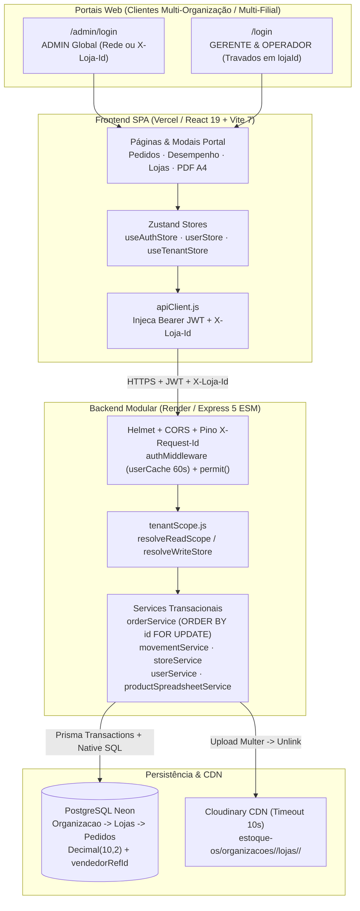
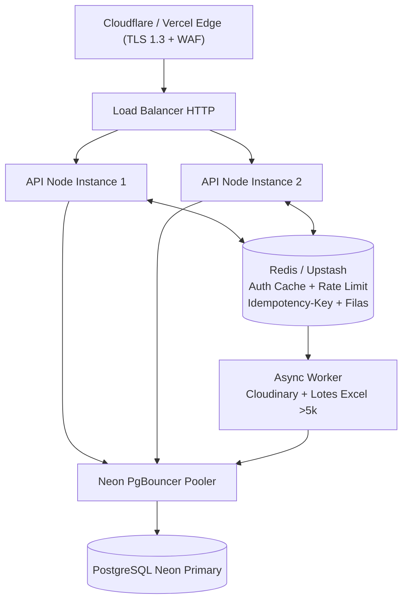

# 📑 RELATÓRIO TÉCNICO 09 — ARQUITETURA E SYSTEM DESIGN
**Projeto:** Estoque.OS  
**Data da Atualização:** 2026-11-10  
**Branch Auditada:** `feature/multitenant`  
**Nível:** MEDIUM (Monólito Modular Multi-Organização / Multi-Filial vs Alvo Escalável)  

---

## 1. Diagrama da Arquitetura Atual Implementada (Pós-Fase H) `[IMPLEMENTADO (verificado)]`

---

## 2. Arquitetura Alvo Recomendada (+100 Usuários Simultâneos / Multi-Instância) `[RECOMENDAÇÃO]`

### Principais Pontos de Atenção para Escala Horizontal
- Hoje `userCache`, `namesCacheByScope`, `idempotencyStore`, `orderIdempotencyStore` e `rate-limit` residem em RAM de processo único (`Map`), funcionando com consistência perfeita em **1 instância** (Render standard/free), mas exigirão **Redis** antes de ativar *horizontal auto-scaling*.
- Uploads de imagem para o Cloudinary ainda rodam de forma síncrona durante o POST/PUT de produtos/usuários (mitigado pelo timeout rígido de 10s).
