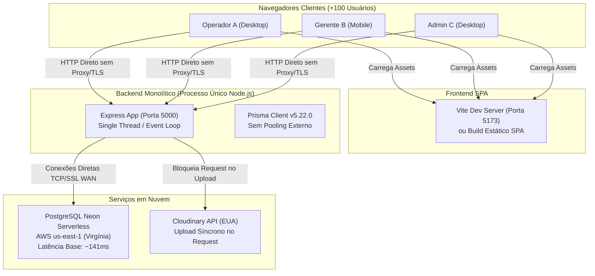
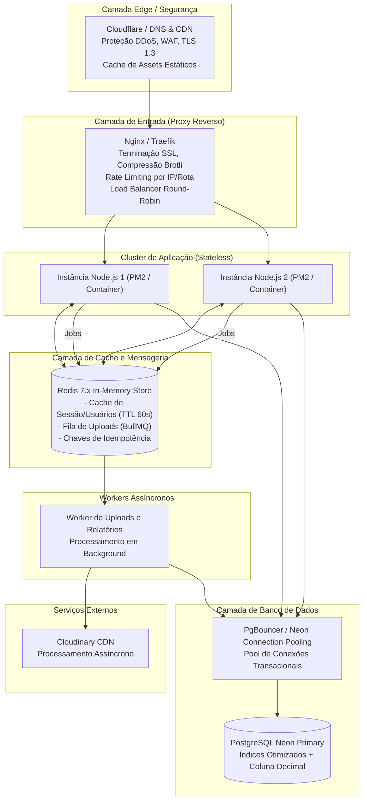

# FASE 6 — ARQUITETURA E SYSTEM DESIGN
**Projeto:** Estoque.OS  
**Data:** 08/11/2026  
**Nível:** MEDIUM (Foco: Concorrência e Escalabilidade para +100 Usuários Simultâneos)  
**Status do Mapeamento:** Em andamento (Fase 6 de 8)

---

## 1. VISÃO COMPARATIVA GERAL

Esta seção contrasta a arquitetura técnica implementada atualmente no **Estoque.OS** com a arquitetura alvo recomendada para suportar com estabilidade operacional e baixa latência **mais de 100 usuários corporativos simultâneos**.

### 1.1 Diagrama da Arquitetura Atual



#### Características da Arquitetura Atual
- **Processo Único:** Backend executado em processo Node.js único sem gerenciador de cluster (PM2 ou Docker).
- **Sem Proxy Reverso:** Requisições chegam diretamente ao Express; ausência de terminação TLS nativa, compactação Gzip/Brotli e rate limiting em nível de rede.
- **Acoplamento Síncrono com Terceiros:** Upload de fotos de produtos aguarda a resposta do Cloudinary (EUA) antes de responder ao navegador do usuário.
- **Latência WAN em Cada Operação:** Cada verificação de usuário ou consulta simples sofre a penalidade de ~141ms de ida e volta para a AWS us-east-1.
- **Estado Parcial em Memória:** Rate limiter armazenado em memória local do processo (incompatível com múltiplas instâncias).

---

### 1.2 Diagrama da Arquitetura Recomendada



---

## 2. AVALIAÇÃO SISTEMÁTICA POR COMPONENTE

Classificação de cada tecnologia conforme as regras da Seção 8 do Prompt Master: **necessário agora**, **prematuro** ou **inadequado**, explicitando o problema concreto que o justifica.

---

### 2.1 Proxy Reverso e Terminação TLS (Nginx / Caddy / Cloudflare)
- **Classificação:** **NECESSÁRIO AGORA**.
- **Problema Concreto que Justifica:**
  Atualmente, o Express atende requisições HTTP diretamente na porta 5000. Em um ambiente corporativo com mais de 100 usuários simultâneos:
  1. A terminação de TLS (HTTPS) na camada do Node.js consome ciclos valiosos do Event Loop que deveriam estar processando lógica de negócios.
  2. Arquivos estáticos do frontend (JS bundles, CSS, fontes) consom sockets do Node.js.
  3. Ausência de compressão Gzip/Brotli faz com que respostas JSON paginadas trafeguem sem compressão, aumentando a latência percebida em redes corporativas ou móveis.
- **Implementação Recomendada:**
  Utilizar Nginx como reverse proxy na frente da aplicação, terminando SSL (Let's Encrypt), compactando respostas com Gzip/Brotli e roteando `/api/` para o cluster Node.js e `/` para o build estático do Vite.

---

### 2.2 Balanceamento de Carga e Escala Horizontal (Múltiplas Instâncias)
- **Classificação:** **NECESSÁRIO AGORA (Cluster Local via PM2)** / **PREMATURO (Kubernetes / Multi-Região)**.
- **Problema Concreto que Justifica:**
  O Node.js executa em thread única de JavaScript. Se uma requisição pesada (como o cálculo atual de estatísticas com N+1 ou upload síncrono) ocupar a CPU por 200ms, todas as outras 99 requisições de outros operadores ficam enfileiradas esperando o Event Loop desocupar.
- **Implementação Recomendada:**
  - **Agora:** Executar a aplicação via **PM2 em modo cluster** (`pm2 start src/server.js -i max`), distribuindo requisições entre todos os núcleos de CPU disponíveis no servidor (ex: 2 a 4 instâncias locais).
  - **Prematuro:** Orquestração complexa com Kubernetes (K8s) ou arquitetura distribuída multi-nuvem seria um desperdício de tempo e complexidade para o porte atual do projeto.

---

### 2.3 Camada de Cache em Memória Compartilhado (Redis)
- **Classificação:** **NECESSÁRIO AGORA (Para Sessão, Auth e Dropdowns)**.
- **Problema Concreto que Justifica:**
  O banco de dados do projeto está hospedado no Neon na região AWS us-east-1 (Virgínia), enquanto os usuários e o servidor local estão no Brasil.
  A latência base de roundtrip é de **141.2ms**. Toda requisição autenticada dispara uma consulta `findUnique` para validar o usuário no `authMiddleware.js`.
  Com 100 usuários simultâneos clicando na interface, são centenas de roundtrips de 141ms desperdiçados apenas para checar se o token pertence a um usuário ativo.
- **Implementação Recomendada:**
  1. Armazenar o cache de sessão/usuário ativo no Redis com TTL de 60 segundos.
  2. Cachear a lista leve de usuários para dropdowns (`GET /users/names`) e catálogo estático de categorias.
  3. Armazenar chaves de idempotência de movimentações para evitar clique duplo.

---

### 2.4 Fila de Tarefas Assíncronas (BullMQ / RabbitMQ)
- **Classificação:** **NECESSÁRIO AGORA (BullMQ para Uploads de Imagem)** / **INADEQUADO (RabbitMQ / Kafka)**.
- **Problema Concreto que Justifica:**
  Ao cadastrar ou editar um produto com imagem, o método `uploadToCloudinary` executa `fs.writeFile`, faz o upload HTTPS multipart para o Cloudinary nos EUA, aguarda a resposta e só então grava no banco e responde ao usuário.
  Se a conexão internacional oscilar, o request fica preso por 3 a 8 segundos segurando o socket HTTP do navegador.
- **Implementação Recomendada:**
  - **Agora:** BullMQ integrado ao Redis para enfileirar tarefas secundárias (upload de imagens em alta resolução, logs de auditoria em arquivo, relatórios PDF pesados). A API responde `202 Accepted` ou salva uma imagem de preview imediata e delega o processamento pesado ao worker.
  - **Inadequado:** Apache Kafka ou RabbitMQ dedicado adicionariam complexidade de infraestrutura desproporcional para o escopo.

---

### 2.5 Gerenciamento e Pooling de Conexões com o Banco (PgBouncer)
- **Classificação:** **NECESSÁRIO AGORA**.
- **Problema Concreto que Justifica:**
  O PostgreSQL aloca um processo do sistema operacional para cada conexão aberta. No plano Neon Serverless, o limite de conexões simultâneas é restrito. Se 100 usuários dispararem requisições simultâneas em um cluster de instâncias Node.js com o Prisma (que por padrão abre um pool local por processo), o banco esgota conexões com o erro `FATAL: remaining connection slots are reserved for non-replication superuser connections`.
- **Implementação Recomendada:**
  Utilizar a URL com pooling do Neon (porta `6543` com PgBouncer integrado nativamente pelo provedor), configurando a connection string no `.env` para usar pooling de transação (`pgbouncer=true&connection_limit=10`).

---

### 2.6 Separação em Microsserviços
- **Classificação:** **INADEQUADO**.
- **Problema Concreto que Justifica:**
  O sistema possui 86 arquivos, 4 tabelas relacionais (`usuarios`, `produtos`, `fornecedores`, `movimentos`) e 34 endpoints.
  Separar um sistema deste porte em microsserviços (ex: "Serviço de Usuários", "Serviço de Estoque", "Serviço de Relatórios") introduziria latência de rede entre serviços, complexidade de transações distribuídas (Saga), inconsistência eventual e custos desnecessários de infraestrutura, piorando o desempenho.
- **Veredito:** Manter o **Monólito Modular Stateless**, aplicando separação clara de pastas e camadas de serviço (Controller, Service, Repository/Prisma).

---

### 2.7 Observabilidade e Telemetria (Pino + OpenTelemetry / Prometheus)
- **Classificação:** **NECESSÁRIO AGORA (Pino + Métricas Express)** / **PREMATURO (OpenTelemetry Distribuído Completo)**.
- **Problema Concreto que Justifica:**
  Atualmente, o projeto utiliza `console.log` e `console.error` sem padrão estruturado JSON, sem Correlation ID (Request ID) e sem registro do tempo de execução de cada rota. Quando ocorre um erro sob concorrência, é impossível rastrear qual usuário ou requisição gerou o erro nos logs.
- **Implementação Recomendada:**
  - Substituir o Morgan/Console pelo **Pino** (logger JSON de altíssima performance para Node.js).
  - Middleware de Request ID injetando cabeçalho `X-Request-Id` em cada requisição.
  - Endpoint seguro de métricas `GET /metrics` expondo métricas Prometheus de latência e consumo de memória.

---

## 3. DIMENSIONAMENTO DE RECURSOS PARA +100 USUÁRIOS SIMULTÂNEOS

### 3.1 Projeção de Throughput e Conexões
- **Base de Usuários:** 100 usuários simultâneos ativos operando no sistema.
- **Taxa de Requisições por Usuário:** Estima-se 1 requisição a cada 3 a 5 segundos por operador ativo durante pico de operação.
- **Throughput do Sistema no Pico:**
  $$\text{Throughput} \approx \frac{100 \text{ usuários}}{3 \text{ segundos}} \approx 33,3 \text{ RPS (Requisições por Segundo)}$$
- **Capacidade Atual com N+1:**
  A rota `GET /movements/user-stats` levou `2.23s` sob concorrência 10. Em 33 RPS, o backend atual colapsaria com timeout e esgotamento do pool.
- **Capacidade com Otimizações Propostas (Fase 5):**
  Com a rota agregada em SQL nativo (~180ms p50) e cache de autenticação em memória, cada requisição consome menos de 2ms de CPU no Node.js. Um cluster de 2 a 4 workers Node.js suporta com folga mais de **150 a 200 RPS**, atendendo perfeitamente a meta de +100 usuários.

### 3.2 Dimensionamento de Servidor Recomendado
| Componente | Especificação Mínima Recomendada | Finalidade |
|---|---|---|
| **CPU** | 2 vCPUs (Intel Xeon / AMD EPYC) | 2 workers Node.js (PM2 cluster) + 1 worker Nginx |
| **Memória RAM** | 2 GB a 4 GB RAM | 300 MB por worker Node + 100 MB Redis + Sistema Operacional |
| **Armazenamento** | 20 GB SSD NVMe | Sistema, logs estruturados e builds estáticos |
| **Banco de Dados** | Neon PostgreSQL (Plano Launch ou Pro) | Pool PgBouncer ativo (limite de 20-50 conexões transacionais) |
| **Cache/Filas** | Redis Server 7.x (local ou Upstash) | Cache de usuários, rate limiting distribuído e BullMQ |

---

## 4. RESUMO EXECUTIVO DO SYSTEM DESIGN

```
+-----------------------------------------------------------------------------------+
|                           FLUXO DE UMA REQUISIÇÃO OTIMIZADA                       |
+-----------------------------------------------------------------------------------+
| 1. Cliente (HTTPS) -> Cloudflare Edge (CDN / WAF / Proteção DDoS)                 |
| 2. Cloudflare -> Nginx Reverse Proxy (Gzip, Terminação SSL, Rate Limit)           |
| 3. Nginx -> PM2 Node.js Cluster (Balanceamento Round-Robin entre CPU Cores)       |
| 4. Node.js -> Middleware de Auth checa Token no Redis Cache (Economia de 141ms)   |
| 5. Node.js -> Service executa Transação Atômica com Lock no PostgreSQL Neon       |
| 6. PgBouncer -> Pool reutilizado sem esgotamento de conexões                      |
| 7. Se houver upload de mídia -> Dispara Job no BullMQ e responde imediatamente     |
| 8. Resposta compactada devolvida ao Cliente em < 200ms                            |
+-----------------------------------------------------------------------------------+
```

A arquitetura recomendada não introduz ferramentas supérfluas ou microsserviços desnecessários, focando cirurgicamente na resolução da latência WAN e no controle de concorrência necessários para 100 usuários simultâneos.

