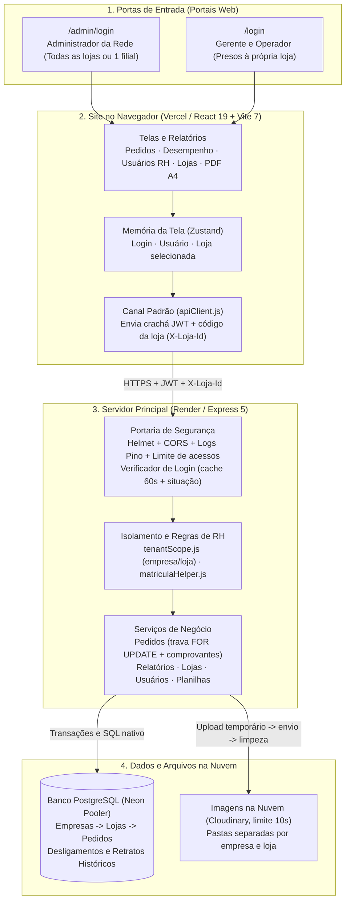
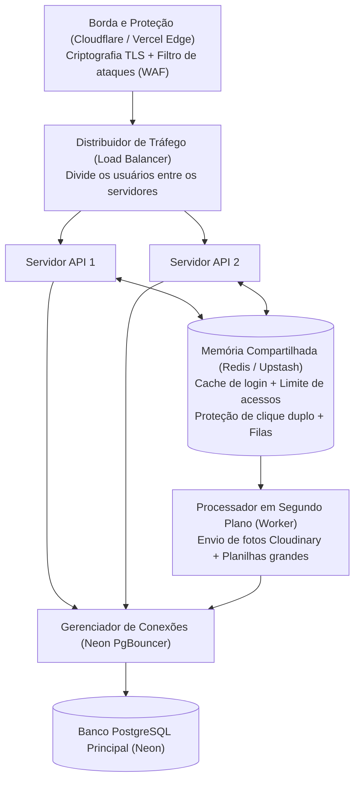

# 📑 RELATÓRIO 09 — ARQUITETURA E DESENHO DO SISTEMA (HOJE × ESCALA FUTURA)

**Projeto:** Estoque.OS  
**Data da atualização:** 2026-11-17 *(base técnica verificada em 2026-11-11 na branch `main`)*  
**Nível de arquitetura atual:** Intermediário (`MEDIUM`) — um servidor principal organizado em módulos atendendo múltiplas empresas e várias lojas.  
**Documentos relacionados:** [Guia de Leitura e Glossário](file:///c:/Users/Ique%20Santana/Desktop/Mateus/vscode/projetos/portifolio/Estoque.OS/relatorios/00_GUIA_DE_LEITURA_E_GLOSSARIO.md) · [Relatório 11 — Catálogo Completo de Problemas](file:///c:/Users/Ique%20Santana/Desktop/Mateus/vscode/projetos/portifolio/Estoque.OS/relatorios/11_matriz_consolidada_de_falhas.md)

---

## Resumo para quem não é técnico

A **arquitetura** de um sistema é como a planta baixa de um prédio: mostra onde fica a recepção (telas do site), onde fica o escritório que faz as contas e verifica permissões (servidor), onde ficam os arquivos (banco de dados) e onde ficam guardadas as fotos (nuvem).

Hoje, o **Estoque.OS** roda numa estrutura enxuta, barata e bem organizada em **1 servidor** (Render) conectado a um banco de dados na nuvem (Neon) e a um serviço de imagens (Cloudinary) — o suficiente para começar com segurança. Se no futuro o sistema crescer para **mais de 100 usuários clicando ao mesmo tempo** e precisar ligar **2 ou mais servidores em paralelo**, este relatório mostra exatamente quais peças novas precisarão entrar (como um distribuidor de tráfego e um servidor de memória compartilhada chamado **Redis**).

---

## 1. Como a arquitetura funciona HOJE `[VERIFICADO]`

### O que cada caixa do desenho faz (em uma frase)
- **Portas de Entrada (`/admin/login` e `/login`):** separam o acesso de quem administra a rede inteira do acesso de quem opera uma filial específica.
- **Site no Navegador (Vercel / React):** desenha todas as telas, guarda temporariamente qual loja está selecionada (`Zustand`) e conversa com o servidor pelo canal padrão (`apiClient.js`).
- **Portaria de Segurança (Render / Express):** confere se o site de origem é confiável (`CORS`), limita acessos excessivos (`apiLimiter`), gera o código de rastreio (`X-Request-Id`) e verifica se o usuário está logado e ativo (`authMiddleware`).
- **Isolamento e Regras de RH (`tenantScope.js` / `matriculaHelper.js`):** garante que nenhuma empresa enxergue dados de outra e gerencia matrículas (`MAT-00001`) e relatórios de demissão.
- **Serviços de Negócio:** executam vendas, estornos, cálculos de desempenho, importação de planilhas e gestão de lojas com transações seguras no banco.
- **Banco PostgreSQL (Neon Pooler):** guarda todos os dados de forma definitiva usando um gerenciador de conexões (*pooler*) para evitar esgotamento.
- **Imagens na Nuvem (Cloudinary):** armazena fotos de produtos, avatares e comprovantes em pastas separadas por empresa e loja, com limite máximo de espera de `10 segundos`.

---

## 2. Como a arquitetura deve evoluir no futuro (+100 usuários simultâneos / vários servidores) `[RECOMENDAÇÃO]`

*Importante: o desenho abaixo **não existe ainda** — é o plano recomendado apenas para quando o volume de acessos exigir ligar 2 ou mais servidores em paralelo.*

### O que muda nesse desenho futuro (e por quê)
- **Distribuidor de Tráfego (*Load Balancer*):** reparte os usuários entre 2 ou mais servidores para que, se um reiniciar ou ficar cheio, o outro segure o movimento sem parar o site.
- **Memória Compartilhada (**Redis**):** hoje, 5 controles importantes (`userCache`, `namesCacheByScope`, `idempotencyStore`, `orderIdempotencyStore` e `rate-limit`) ficam na memória RAM de 1 único servidor. Como detalhado em [`OPERACAO-06`](file:///c:/Users/Ique%20Santana/Desktop/Mateus/vscode/projetos/portifolio/Estoque.OS/relatorios/11_matriz_consolidada_de_falhas.md#operacao-06), eles precisam ir para o **Redis** antes de ligar um segundo servidor em paralelo.
- **Processador em Segundo Plano (*Worker*) ou Upload Direto:** tira o envio de fotos do Cloudinary e importações gigantes do tempo de espera da tela principal, resolvendo [`DESEMPENHO-07`](file:///c:/Users/Ique%20Santana/Desktop/Mateus/vscode/projetos/portifolio/Estoque.OS/relatorios/11_matriz_consolidada_de_falhas.md#desempenho-07).
- **Gerenciador de Conexões (`PgBouncer` / Neon Pooler):** já está ativo hoje ([`OPERACAO-05`](file:///c:/Users/Ique%20Santana/Desktop/Mateus/vscode/projetos/portifolio/Estoque.OS/relatorios/11_matriz_consolidada_de_falhas.md#operacao-05)) e continua essencial quando houver múltiplos servidores dividindo o mesmo banco.

### Antes de gastar com escala horizontal, o que medir primeiro
1. Rodar uma medição cronometrada de carga HTTP (p50/p95) no estado atual — hoje marcada como `NÃO MEDIDO` no [Relatório 07](file:///c:/Users/Ique%20Santana/Desktop/Mateus/vscode/projetos/portifolio/Estoque.OS/relatorios/07_diagnostico_auditoria_e_performance.md).
2. Resolver primeiro os gargalos baratos de código: dividir o arquivo do site (`DESEMPENHO-08`) e tirar `limit=all` do gráfico mensal (`DESEMPENHO-01` / `DESEMPENHO-03`).
