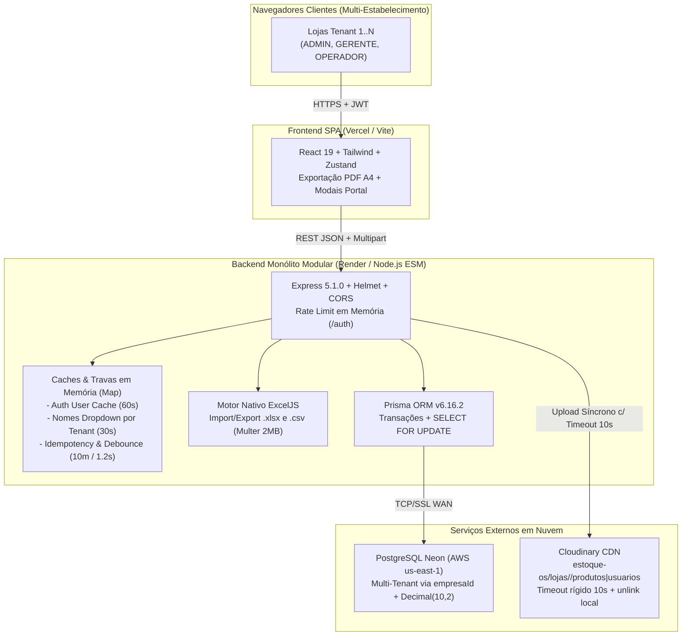
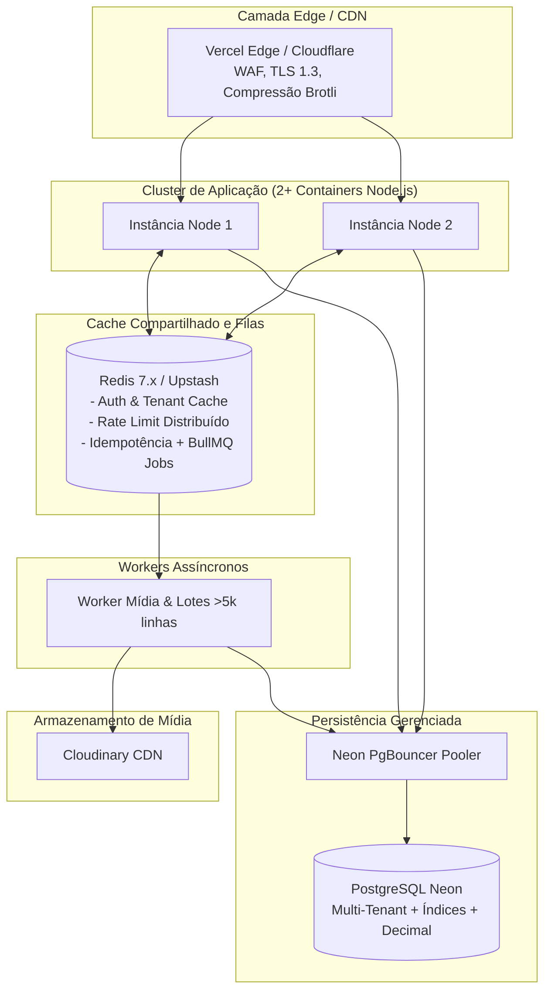

# FASE 6 — ARQUITETURA E SYSTEM DESIGN
**Projeto:** Estoque.OS  
**Data da Atualização:** 10/11/2026  
**Branch:** `feature/multitenant`  
**Nível:** MEDIUM (Arquitetura Multi-Tenant Atual vs. Alvo para +100 Usuários Simultâneos)  

---

## 1. VISÃO COMPARATIVA GERAL

Esta análise contrasta a arquitetura efetivamente implementada no **Estoque.OS** após as **Fases A–G** (Multi-Tenant, Soft Delete, Cache In-Memory, Lock `FOR UPDATE`, `ExcelJS` nativo, Pino + `X-Request-Id` e Graceful Shutdown) com a arquitetura alvo recomendada para escalar horizontalmente acima de **100 operadores simultâneos** em múltiplas instâncias.

### 1.1 Diagrama da Arquitetura Atual (Pós-Fase G)

#### Características Reais da Arquitetura Atual
- **Monólito Modular Multi-Tenant Stateless em Banco:** Isolamento estrito em banco único via `empresaId` e índices compostos em todos os modelos (`Empresa`, `Usuario`, `Categoria`, `Fornecedor`, `Produto`, `Movimento`), além de subpastas isoladas no Cloudinary.
- **Processamento Nativo em Node.js:** Importação/exportação de planilhas executada diretamente pelo serviço [`productSpreadsheetService.js`](file:///c:/Users/Ique%20Santana/Desktop/Mateus/vscode/projetos/portifolio/Estoque.OS/backend/src/services/productSpreadsheetService.js) via `ExcelJS`, evitando o custo operacional de manter um microservidor/worker Python separado no Render.
- **Observabilidade e Encerramento:** Logger estruturado `Pino` com `X-Request-Id` (`requestLogger.js`), cabeçalhos `Helmet`, e `Graceful Shutdown` (`SIGTERM`/`SIGINT`) em [`index.js`](file:///c:/Users/Ique%20Santana/Desktop/Mateus/vscode/projetos/portifolio/Estoque.OS/backend/src/index.js#L93-L116).
- **Ponto de Atenção para Escala Horizontal:** `userCache` (`authMiddleware.js`), `namesCacheByTenant` (`userController.js`), `idempotencyStore`/`recentOperations` (`productService.js`) e `express-rate-limit` residem na **memória RAM local (`Map`)** de uma única instância Node.js. Escalar para 2+ containers quebraria a consistência desses caches e limitadores sem Redis.

---

### 1.2 Diagrama da Arquitetura Recomendada (+100 Usuários Simultâneos / Multi-Instância)

---

## 2. AVALIAÇÃO SISTEMÁTICA POR COMPONENTE (PÓS-FASE G)

### 2.1 Proxy Reverso, TLS e Compressão
- **Estado Atual:** Em produção na dupla **Vercel (Frontend)** + **Render (Backend)**, o roteamento Edge HTTPS é provido pela plataforma; porém, em self-hosting cru no VPS, ainda não há `Nginx`/`Dockerfile` versionado no repositório nem middleware `compression()` no Express.
- **Classificação:** **NECESSÁRIO EM SELF-HOSTING / CONFIGURÁVEL VIA PLATAFORMA EM PAAS**.

### 2.2 Clusterização e Escala Horizontal
- **Estado Atual:** Instância única Node.js (compatível com plano Starter do Render).
- **Classificação:** **NECESSÁRIO AO PASSAR DE 1 INSTÂNCIA (PM2 / Réplicas) + PREMATURO usar Kubernetes hoje**.

### 2.3 Camada de Cache Compartilhado (Redis / Upstash)
- **O que já existe:** Cache `Map()` em RAM em `authMiddleware.js` (60s, invalidado no `PATCH/PUT/DELETE`) e `userController.js` (30s por `empresaId`), mitigando o roundtrip WAN (~141ms) para AWS `us-east-1`.
- **O que falta para cluster (>1 instância):** Migrar `userCache`, `namesCacheByTenant`, `idempotencyStore` e `rate-limit` para Redis compartilhado. Sem isso, uma segunda instância não enxerga a invalidação nem o bloqueio de idempotência da primeira.

### 2.4 Fila de Tarefas Assíncronas (BullMQ)
- **Estado Atual:** Uploads de imagens até 5MB ocorrem no ciclo HTTP síncrono com proteção de timeout de 10s (`Promise.race` + `fs.unlink`), e planilhas `.xlsx`/`.csv` operam em memória até 2MB / 5.000 linhas dentro do request.
- **Classificação:** **OPCIONAL HOJE (para <= 5.000 linhas e imagens < 5MB)**; **NECESSÁRIO com BullMQ** caso lojas passem a importar catálogos > 10.000 SKUs ou múltiplas imagens em lote.

### 2.5 Pooling de Conexões (Neon PgBouncer)
- **Classificação:** **OBRIGATÓRIO EM PRODUÇÃO.** Sempre usar a URL `-pooler` do Neon (`?sslmode=require&pgbouncer=true` quando aplicável) para impedir esgotamento de conexões sob picos de concorrência. *(Regra de manutenção: URL direta sem pooler apenas para executar `prisma migrate deploy` se necessário).*

### 2.6 Separação em Microsserviços (ou Worker Python Externo)
- **Classificação:** **INADEQUADO.**
- **Justificativa Concreta:** O código soma **101 arquivos de código em `src/`** (30 backend + 71 frontend), **6 tabelas relacionais** e **42 rotas HTTP**. Introduzir microsserviços ou um servidor Python separado apenas para planilhas adicionaria latência de rede, custo de segundo container e falhas distribuídas sem ganho técnico frente ao motor nativo já entregue em [`productSpreadsheetService.js`](file:///c:/Users/Ique%20Santana/Desktop/Mateus/vscode/projetos/portifolio/Estoque.OS/backend/src/services/productSpreadsheetService.js).

### 2.7 Observabilidade e Telemetria
- **Estado Atual:** **Pino Logger JSON** + **Correlation ID (`X-Request-Id`)** + rotas `/test-db` e `/` **JÁ IMPLEMENTADOS**.
- **Lacuna Remanescente:** Falta apenas coleta externa de exceções/APM (ex.: Sentry) e endpoint `/metrics` caso migre para VPS dedicada.

---

## 3. RESUMO EXECUTIVO DE CAPACIDADE

- **Concorrência de Escrita em Estoque:** Protegida por `SELECT ... FOR UPDATE` + `empresaId` e trava de idempotência/debounce.
- **Gargalos Eliminados (Fases B–G):** N+1 em `/movements/user-stats`, N+1/triplo include em `/suppliers/stats`, cálculos financeiros em `Float`, falta de isolamento multi-tenant e ausência de Soft Delete.
- **Principal Limite Técnico Atual:** Gráficos de histórico no frontend (`StockFlowChart.jsx` e `Movimentacoes.jsx`) ainda consomem `GET /movements?limit=all` carregando todo o histórico do tenant na abertura da tela — ponto prioritário para otimização por agregação SQL no futuro quando uma loja ultrapassar milhares de movimentações.
