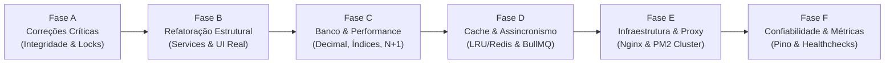

# FASE 7 — PLANO CONSOLIDADO DE IMPLEMENTAÇÃO
**Projeto:** Estoque.OS  
**Data:** 08/11/2026  
**Nível:** MEDIUM  
**Status do Mapeamento:** Em andamento (Fase 7 de 8)

---

## 1. VISÃO GERAL DO PLANO DE EXECUÇÃO

Este plano estabelece a ordem cronológica e técnica exata para a implementação de todas as melhorias e correções mapeadas nas fases anteriores do **Estoque.OS**. O roteiro está organizado em **6 Fases de Engenharia (Fases A a F)**, respeitando dependências diretas de código, estabilidade do banco de dados e mitigação de riscos operacionais.



---

## 2. DETALHAMENTO DAS FASES DE IMPLEMENTAÇÃO

---

### FASE A — CORREÇÕES CRÍTICAS (Segurança, Integridade e Bugs Graves)

#### ITEM A.1: Concorrência Atômica no Saldo de Estoque (I1, I2, I9)
- **Objetivo:** Impedir condições de corrida (*lost update*) e saldo negativo em saídas simultâneas.
- **Arquivos Envolvidos:**
  - [`backend/src/services/productService.js`](file:///c:/Users/Ique%20Santana/Desktop/Mateus/vscode/projetos/portifolio/Estoque.OS/backend/src/services/productService.js)
  - [`backend/src/controllers/productController.js`](file:///c:/Users/Ique%20Santana/Desktop/Mateus/vscode/projetos/portifolio/Estoque.OS/backend/src/controllers/productController.js)
- **Funções:** `adjustProductQuantity`, `adjustQuantity`
- **Ações de Código:**
  1. Envolver a verificação e gravação em transação interativa com bloqueio pessimista (`tx.$queryRaw... FOR UPDATE` ou decremento condicional atômico).
  2. Implementar validação estrita de saldo no banco de dados.
  3. Adicionar suporte ao cabeçalho `Idempotency-Key` no controller para evitar duplicidade de duplo clique.
- **Riscos:** Contenção de locks se transações demorarem. O bloco `tx` deve executar apenas comandos de banco em memória rápida.
- **Critério de Conclusão:** Teste de estresse com 20 requisições simultâneas debitando itens com saldo limitado resulta em exatamente o número correto de sucessos sem nenhum saldo negativo.
- **Estratégia de Rollback:** Reverter o arquivo `productService.js` para a versão anterior via Git checkout; o schema do banco não é alterado neste item.

#### ITEM A.2: Proteção contra Rebaixamento ou Exclusão do Último Administrador (B7)
- **Objetivo:** Eliminar o risco de lockout total da gestão administrativa.
- **Arquivos Envolvidos:**
  - [`backend/src/services/userService.js`](file:///c:/Users/Ique%20Santana/Desktop/Mateus/vscode/projetos/portifolio/Estoque.OS/backend/src/services/userService.js)
- **Funções:** `updateUser`, `deleteUser`, `updateMe`
- **Ações de Código:**
  1. Adicionar função `checkLastAdminGuard` que conta administradores no banco (`count({ where: { papel: 'ADMIN' } })`).
  2. Se a contagem for `<= 1` e a operação tentar alterar o papel ou deletar o admin, lançar erro 400.
- **Riscos:** Mínimo.
- **Critério de Conclusão:** Requisição `PUT /users/:id` com `{ papel: 'OPERADOR' }` disparada para o único admin retorna `400 Bad Request` com mensagem explicativa.
- **Estratégia de Rollback:** Reverter commit do `userService.js`.

#### ITEM A.3: Rate Limiting na Rota de Cadastro de Usuários (I10)
- **Objetivo:** Proteger a CPU contra DoS em hashing de senhas e evitar injeção de contas fantasmas.
- **Arquivos Envolvidos:**
  - [`backend/src/middlewares/rateLimiter.js`](file:///c:/Users/Ique%20Santana/Desktop/Mateus/vscode/projetos/portifolio/Estoque.OS/backend/src/middlewares/rateLimiter.js)
  - [`backend/src/routes/authRoutes.js`](file:///c:/Users/Ique%20Santana/Desktop/Mateus/vscode/projetos/portifolio/Estoque.OS/backend/src/routes/authRoutes.js)
- **Ações de Código:**
  1. Criar `registerLimiter` (limite de 5 registros por hora por IP).
  2. Acoplar o middleware na rota `POST /auth/register`.
- **Riscos:** Usuários em rede corporativa com NAT compartilhando o mesmo IP. Limite calibrado para 5 registros/hora mitiga falsos positivos.
- **Critério de Conclusão:** A 6ª tentativa de registro no mesmo IP retorna `429 Too Many Requests`.
- **Estratégia de Rollback:** Remover o middleware da rota em `authRoutes.js`.

---

### FASE B — REFATORAÇÃO ESTRUTURAL (Camadas, Limpeza e UI Real)

#### ITEM B.1: Eliminação de N+1 e Acoplamento em Movimentações (I3)
- **Objetivo:** Reduzir a latência de `3.12s` para menos de `300ms` em concorrência.
- **Arquivos Envolvidos:**
  - [`backend/src/controllers/movementController.js`](file:///c:/Users/Ique%20Santana/Desktop/Mateus/vscode/projetos/portifolio/Estoque.OS/backend/src/controllers/movementController.js)
  - [`backend/src/services/movementService.js`](file:///c:/Users/Ique%20Santana/Desktop/Mateus/vscode/projetos/portifolio/Estoque.OS/backend/src/services/movementService.js)
- **Funções:** `getUserStats` -> `getUserStatsAggregated`
- **Ações de Código:**
  1. Conectar `movementController.getUserStats` ao método `movementService.getUserStatsAggregated`.
  2. Remover as 4 queries individuais do loop `map` do controller.
- **Riscos:** Divergência de payload com o frontend.
- **Critério de Conclusão:** O painel de estatísticas em [`Movimentacoes.jsx`](file:///c:/Users/Ique%20Santana/Desktop/Mateus/vscode/projetos/portifolio/Estoque.OS/frontend/src/pages/Movimentacoes.jsx) renderiza exatamente os mesmos dados com latência de resposta inferior a 350ms.
- **Estratégia de Rollback:** Restaurar a chamada do controller via Git.

#### ITEM B.2: Conexão da Camada de Serviço de Fornecedores e Agregação SQL (I4)
- **Objetivo:** Corrigir a quebra de padrão em que `supplierController` ignorava `supplierService`.
- **Arquivos Envolvidos:**
  - [`backend/src/controllers/supplierController.js`](file:///c:/Users/Ique%20Santana/Desktop/Mateus/vscode/projetos/portifolio/Estoque.OS/backend/src/controllers/supplierController.js)
  - [`backend/src/services/supplierService.js`](file:///c:/Users/Ique%20Santana/Desktop/Mateus/vscode/projetos/portifolio/Estoque.OS/backend/src/services/supplierService.js)
- **Ações de Código:**
  1. Transferir a lógica de banco de `supplierController.js` para `supplierService.js`.
  2. Substituir `reduce` em arrays JavaScript por `prisma.produto.aggregate`.
- **Critério de Conclusão:** `supplierController.js` livre de chamadas diretas ao `prisma`.
- **Estratégia de Rollback:** Reversão do commit de fornecedores.

#### ITEM B.3: Implementação Real de Soft-Delete e Conexão na UI (B6, B3)
- **Objetivo:** Substituir o modal estático "desativado" por inativação lógica de contas com preservação de auditoria.
- **Arquivos Envolvidos:**
  - [`backend/prisma/schema.prisma`](file:///c:/Users/Ique%20Santana/Desktop/Mateus/vscode/projetos/portifolio/Estoque.OS/backend/prisma/schema.prisma)
  - [`backend/src/services/userService.js`](file:///c:/Users/Ique%20Santana/Desktop/Mateus/vscode/projetos/portifolio/Estoque.OS/backend/src/services/userService.js)
  - [`frontend/src/pages/Usuarios.jsx`](file:///c:/Users/Ique%20Santana/Desktop/Mateus/vscode/projetos/portifolio/Estoque.OS/frontend/src/pages/Usuarios.jsx)
- **Ações de Código:**
  1. Migration Prisma adicionando `ativo Boolean @default(true)` na tabela `usuarios`.
  2. No backend, `deleteUser` atualiza `ativo: false`.
  3. No frontend, botão "Excluir" dispara `apiClient.delete('/users/' + id)` com confirmação e feedback visual.
- **Critério de Conclusão:** Usuário inativado não consegue logar, mas suas movimentações históricas continuam exibindo seu nome no sistema.
- **Estratégia de Rollback:** Reverter migration via Prisma migrate e restaurar código do frontend.

#### ITEM B.4: Padronização do Cliente HTTP no Frontend e Limpeza de Código Morto (B9)
- **Objetivo:** Eliminar duplicações de chamadas e remover arquivos não utilizados.
- **Arquivos Envolvidos:**
  - [`frontend/src/services/apiClient.js`](file:///c:/Users/Ique%20Santana/Desktop/Mateus/vscode/projetos/portifolio/Estoque.OS/frontend/src/services/apiClient.js)
  - [`frontend/src/dados.js`](file:///c:/Users/Ique%20Santana/Desktop/Mateus/vscode/projetos/portifolio/Estoque.OS/frontend/src/dados.js) (código morto)
- **Ações de Código:**
  1. Adicionar interceptor de 401 no `apiClient.js` para deslogar em caso de token expirado.
  2. Excluir com segurança o arquivo mock `frontend/src/dados.js`.
- **Critério de Conclusão:** Token expirado força redirecionamento limpo para `/login` sem erros no console.

---

### FASE C — BANCO DE DADOS E PERFORMANCE (Tipos, Índices e Pooling)

#### ITEM C.1: Migração de Precisão Monetária (Float para Decimal) (I7)
- **Objetivo:** Eliminar erros de arredondamento financeiro e dízimas periódicas.
- **Arquivos Envolvidos:**
  - [`backend/prisma/schema.prisma`](file:///c:/Users/Ique%20Santana/Desktop/Mateus/vscode/projetos/portifolio/Estoque.OS/backend/prisma/schema.prisma)
  - [`backend/src/services/productService.js`](file:///c:/Users/Ique%20Santana/Desktop/Mateus/vscode/projetos/portifolio/Estoque.OS/backend/src/services/productService.js)
- **Migrations:** `npx prisma migrate dev --name change_preco_to_decimal`
- **Ações de Código:**
  1. Alterar `preco Float` para `preco Decimal @db.Decimal(10, 2)`.
  2. Garantir conversão de serialização no Express.
- **Riscos:** Conversão de tipos no PostgreSQL. Como são poucos registros e preços padrão (ex: `19.99`), a conversão é transparente e segura.
- **Critério de Conclusão:** Coluna `preco` no Neon passa a ser do tipo `numeric(10, 2)`.
- **Estratégia de Rollback:** Migration reversa alterando a coluna de volta para `double precision`.

#### ITEM C.2: Adição de Índices Compostos Estratégicos (I6)
- **Objetivo:** Acelerar ordenações paginadas e evitar sequential scans com o crescimento do banco.
- **Arquivos Envolvidos:**
  - [`backend/prisma/schema.prisma`](file:///c:/Users/Ique%20Santana/Desktop/Mateus/vscode/projetos/portifolio/Estoque.OS/backend/prisma/schema.prisma)
- **Ações de Código:**
  1. Adicionar índice composto `@@index([produtoId, data])` no model `Movimento`.
  2. Adicionar índice composto `@@index([categoria, quantidade])` no model `Produto`.
- **Critério de Conclusão:** EXPLAIN ANALYZE em consultas paginadas de movimentações utiliza Index Scan ao invés de Seq Scan.
- **Estratégia de Rollback:** Remover as anotações `@@index` e gerar migração de drop.

#### ITEM C.3: Ativação de Connection Pooling PgBouncer no Neon (A4)
- **Objetivo:** Suportar mais de 100 conexões concorrentes sem esgotar os limites do PostgreSQL.
- **Arquivos Envolvidos:**
  - `backend/.env`
- **Ações de Código:**
  1. Configurar a URL de pooling do Neon (porta `6543` com flag `?pgbouncer=true`).
  2. Ajustar `connection_limit=15` no Prisma Client.
- **Critério de Conclusão:** Sob carga de 100 conexões simultâneas, nenhuma requisição falha por limite de conexões de banco.
- **Estratégia de Rollback:** Retornar a string de conexão direta do `.env`.

---

### FASE D — CACHE E PROCESSAMENTO ASSÍNCRONO (Redis e Workers)

#### ITEM D.1: Cache de Sessão de Usuários e Catálogo Leve (A1)
- **Objetivo:** Eliminar o roundtrip de 141ms da validação do token JWT em cada requisição.
- **Arquivos Envolvidos:**
  - [`backend/src/middlewares/authMiddleware.js`](file:///c:/Users/Ique%20Santana/Desktop/Mateus/vscode/projetos/portifolio/Estoque.OS/backend/src/middlewares/authMiddleware.js)
  - [`backend/src/services/userService.js`](file:///c:/Users/Ique%20Santana/Desktop/Mateus/vscode/projetos/portifolio/Estoque.OS/backend/src/services/userService.js)
- **Ações de Código:**
  1. Cachear perfil do usuário autenticado com TTL de 60 segundos.
  2. Invalidar cache na alteração de dados de usuário.
- **Critério de Conclusão:** Latência de requisições autenticadas subsequentes cai em ~140ms.
- **Estratégia de Rollback:** Desabilitar a checagem no middleware mantendo a consulta direta.

#### ITEM D.2: Fila Assíncrona para Upload de Mídia no Cloudinary (A2)
- **Objetivo:** Desbloquear o request HTTP na criação de produtos com imagem.
- **Arquivos Envolvidos:**
  - [`backend/src/utils/cloudinary.js`](file:///c:/Users/Ique%20Santana/Desktop/Mateus/vscode/projetos/portifolio/Estoque.OS/backend/src/utils/cloudinary.js)
  - [`backend/src/services/productService.js`](file:///c:/Users/Ique%20Santana/Desktop/Mateus/vscode/projetos/portifolio/Estoque.OS/backend/src/services/productService.js)
- **Ações de Código:**
  1. Salvar imagem com status provisório ou preview local.
  2. Disparar worker BullMQ para upload no Cloudinary em background.
  3. Atualizar a URL do produto quando o worker concluir.
- **Critério de Conclusão:** Cadastro de produto com imagem responde em menos de 250ms, independentemente do tempo de upload no Cloudinary.
- **Estratégia de Rollback:** Reverter para o upload síncrono original.

---

### FASE E — ESCALABILIDADE E INFRAESTRUTURA (Proxy e Cluster)

#### ITEM E.1: Configuração de Nginx como Reverse Proxy e TLS
- **Objetivo:** Terminação SSL, compressão Gzip e isolamento de portas da aplicação.
- **Arquivos a Criar:**
  - `nginx/default.conf`
  - `docker-compose.yml` (para ambiente de produção local/servidor)
- **Critério de Conclusão:** Aplicação servida via HTTPS na porta 443 com assets compactados.

#### ITEM E.2: Execução em Cluster via PM2
- **Objetivo:** Distribuir o tráfego do Node.js por todos os cores de CPU.
- **Arquivos a Criar:**
  - `backend/ecosystem.config.cjs`
- **Ações:** Configurar execução com `instances: 'max'` e reinício automático em caso de falha de memória.
- **Critério de Conclusão:** Múltiplos workers Node.js atendendo requisições com balanceamento interno.

---

### FASE F — CONFIABILIDADE E OBSERVABILIDADE (Logs, Testes e Métricas)

#### ITEM F.1: Logger Estruturado com Pino e Request ID (A6)
- **Objetivo:** Substituir logs em texto plano por logs estruturados JSON rastreáveis.
- **Arquivos Envolvidos:**
  - [`backend/src/utils/logger.js`](file:///c:/Users/Ique%20Santana/Desktop/Mateus/vscode/projetos/portifolio/Estoque.OS/backend/src/utils/logger.js)
  - [`backend/src/app.js`](file:///c:/Users/Ique%20Santana/Desktop/Mateus/vscode/projetos/portifolio/Estoque.OS/backend/src/app.js)
- **Ações de Código:**
  1. Instalar `pino` e `pino-http`.
  2. Injetar middleware gerador de `X-Request-Id` UUID em cada requisição.
  3. Registrar tempo de execução e status code de forma estruturada.
- **Critério de Conclusão:** Logs do backend impressos em JSON contendo `requestId`, `userId`, `method`, `route` e `durationMs`.

#### ITEM F.2: Suíte de Testes Automatizados com Vitest (I11)
- **Objetivo:** Garantir a não-regressão das regras de negócio `RN-001` a `RN-020`.
- **Arquivos a Criar:**
  - `backend/tests/integration/auth.test.js`
  - `backend/tests/integration/adjust.test.js`
  - `backend/tests/integration/users.test.js`
- **Critério de Conclusão:** Comando `npm test` executa suíte completa com 100% de aprovação nas regras críticas de movimentação e autorização.

#### ITEM F.3: Atualização Integral da Documentação (README.md)
- **Objetivo:** Sincronizar o README oficial do projeto com a realidade do código e as novas melhorias implementadas.
- **Arquivos Envolvidos:**
  - [`README.md`](file:///c:/Users/Ique%20Santana/Desktop/Mateus/vscode/projetos/portifolio/Estoque.OS/README.md)
- **Ações:**
  1. Corrigir discrepâncias de Enums (`REPOSICAO` e `VENDA`).
  2. Atualizar o catálogo de rotas HTTP com os 34 endpoints reais.
  3. Descrever as novas garantias de concorrência atômica, soft-delete e arquitetura de cache.
- **Critério de Conclusão:** Documentação 100% fiel ao código executável do projeto.

---

## 3. MATRIZ DE DEPENDÊNCIAS DAS FASES

```
Fase A (Crítica)  ------>  Fase B (Refatoração)  ------>  Fase C (Banco/Tipos)
       |                            |                           |
       v                            v                           v
Fase D (Cache/Queue) --->  Fase E (Infra/Cluster) --->  Fase F (Testes/Observabilidade)
```

Nenhum deploy das fases posteriores deve ser antecipado sem a validação do critério de conclusão da fase precedente.

